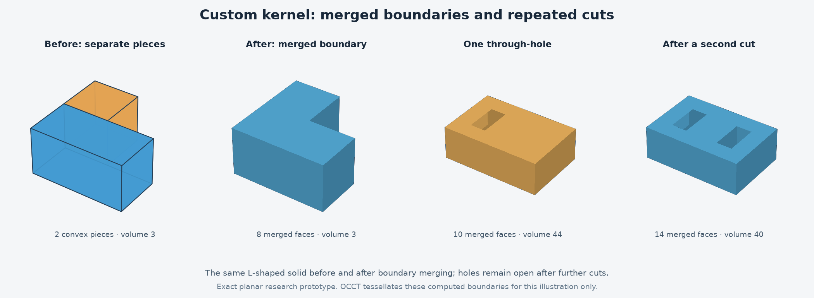

# Custom kernel: merged planar boundaries and repeated cuts

Date: 2026-10-11
Status: completed second feasibility experiment; research code only.

## Outcome

Ivan approved the next experiment: remove internal seams from the convex-piece output and test repeated cuts before curved surfaces. The experiment now builds a merged planar boundary with oriented faces, concave outer loops, hole loops, and connected boundary shells.

The result is meaningful for the restricted planar models tested. It is not a production CAD kernel, a replacement for Autodesk ShapeManager, or a reason to switch the full Fusion recreation away from its approved OCCT baseline.

## What changed

The first experiment represented union and subtraction as convex cells. This experiment retains that representation internally and adds an exact boundary extraction pipeline:

1. Group cell faces by exact supporting plane and orientation.
2. Subtract opposing coplanar face coverage, including partial overlaps.
3. Split edges consistently at shared vertices and cancel interior coplanar edges.
4. Assemble the remaining edges into outer loops and hole loops.
5. Remove a straight-edge vertex only when every incident face agrees that it is redundant.
6. Validate opposite edge use, planar orientation, vertex connectivity, shell topology, and agreement between boundary and cell volumes.

All modeling operations in this pipeline use original Python code and exact rational arithmetic. OCCT is used only for independent comparison and illustration tessellation.

Body.cut, Body.union and Body.intersection support repeated operations on the stored convex-cell representation. Each operation regenerates the merged boundary. This is not a boundary-only Boolean engine; exporting or discarding the cells would not yet leave a model that this probe can edit.

## Verified examples

| Example | Result |
|---|---|
| Two overlapping aligned blocks | One six-face rectangular boundary |
| Blocks meeting along a complete face | Shared face removed; six exterior faces |
| L-shaped union | Eight faces, including concave top and bottom faces |
| Partial face contact | Nine exterior faces with consistent shared edges |
| Closed internal cavity | Twelve faces; positive outer shell and negative inner shell |
| Square through-hole | Ten faces with hole loops on top and bottom |
| Two square through-holes | Four hole loops; expected genus-two shell topology |
| Cut that separates a block | Two closed components, not an incorrectly stitched solid |
| Repeated adjacent cuts | Hole expands correctly; repeating a cut does not change geometry |
| Filling the hole back in | Returns to the six-face block boundary |
| Rotated intersection/union/cut | Valid merged boundaries and conserved volumes |
| Wall only 1e-20 units thick | Exact positive volume retained in the rational-only test |

Edge-only or point-only connections between otherwise separate solids are rejected with BoundaryError. This probe requires a manifold boundary; it does not silently accept nonmanifold contacts.

## Test evidence

30 unittest methods passed: 16 boundary tests plus the original 14 regression tests. The regression suite includes 120 seeded box pairs and 24 seeded rationally rotated pairs. Those generated cases validate the earlier cell kernel; they should not be counted as a generated corpus for the new boundary merger.

Two early checks failed. The L-shape retained redundant collinear vertices; synchronized removal across incident faces resolved that issue. The partial-contact fixture expected ten faces but its independently enumerated exterior planes yield nine; the test expectation was corrected. The final full suite passed in 4.014 seconds on the mini's system Python 3.9.

The boundary tests include cavities, disconnected components, nonmanifold contact rejection, empty results, repeated cuts and unions, face holes, thin walls and non-axis-aligned models.

## Comparison with OCCT

Used the existing isolated environment with cadquery-ocp 8.0.1.1.0. Reference shapes undergo OCCT's own Boolean operations after every step; the custom merged faces are converted separately for comparison.

Twenty operation steps across fourteen workflows passed every configured check:

- Exact boundary volume equals the retained cell volume.
- Volume agrees with OCCT within max(1e-6 cubic units, 1e-8 relative).
- Surface area agrees with OCCT within max(1e-6 square units, 1e-8 relative).
- Each custom converted face passes OCCT face validity checks; the custom exact validator checks the assembled boundary. The OCCT reference result also passes its validity check.
- Bidirectional sampled distance to the other boundary's faces is at most 1e-7 units.

Measured maxima:

| Measurement | Maximum difference |
|---|---:|
| Volume | 2.842170943040401e-14 cubic units |
| Surface area | 7.105427357601002e-15 square units |
| Sampled surface distance | 4.965068306494546e-16 units |

There were 5,253 sample evaluations across the operation steps. Samples include face vertices, edge midpoints and accepted interior UV-grid points. Distances are measured against face compounds, rather than solids whose interiors could mask an incorrect interior surface.

Sampling is not a proof of global boundary equivalence. These tolerances and results apply to this small, bounded planar corpus. The tiny 1e-20 wall is tested only by the exact probe; the OCCT comparison's thin-wall case is 1e-4, consistent with its configured construction tolerances.

## Remaining limitations

- Convex cells remain backing data for future operations; face-only import and editing are unsupported.
- No circles, cylinders, NURBS, fillets, curved intersections or general tolerance strategy.
- No durable face/edge identity, feature history, native document format or production application.
- The boundary builder assumes valid cells with disjoint interiors, as maintained by its operations; it is not a validator for arbitrary external cell soup.
- Shell connectivity and orientation are represented, but a general imported-shell nesting and solid-classification system is not implemented.
- Repeated operations can multiply cells and rational-number sizes. Large assemblies, long editing sequences, adversarial input and production performance have not been demonstrated.
- No automatic recovery of unsupported nonmanifold contacts.

The next bounded question is how to introduce cylinders and circular holes with an explicit numerical policy. Exact rational arithmetic alone cannot represent all general curved-surface intersection coordinates. This should be a separate experiment; general fillets and freeform surfaces remain later work.

## Reproduction and locations

Documentation project: /Volumes/SamsungSSD1/code/fusion-recreation, branch main.
Experiment: /Volumes/SamsungSSD1/tools/fusion-recreation/experiments/2026-10-11-boundary-kernel.
Comparison environment: /Volumes/SamsungSSD1/tools/fusion-recreation/comparison-env.

From the experiment directory on the mini:

```sh
python3 -m unittest -v
/Volumes/SamsungSSD1/tools/fusion-recreation/comparison-env/bin/python compare_boundary.py
```

Files include the unchanged first experiment's kernel.py and test_kernel.py, plus boundary.py, test_boundary.py, fixtures.py, compare_boundary.py, boundary-comparison.json, plot_boundary.py, boundary-experiment.png and evidence-manifest.json. The existing comparison-requirements.txt pins the reference environment. Research code has not been promoted into the product repository.



