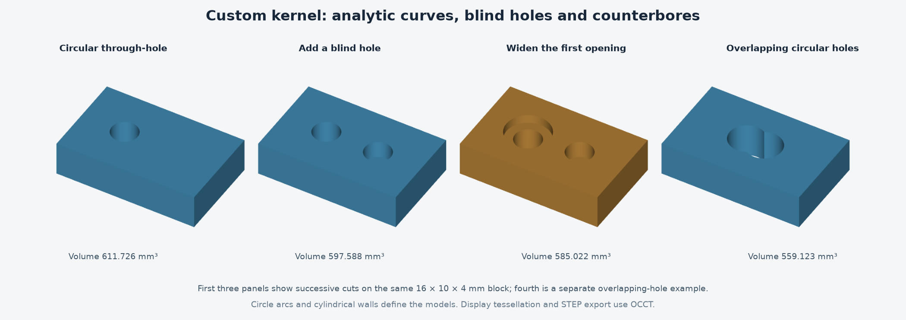

# Custom kernel: analytic cylinders and circular holes

Date: 2026-10-11
Status: completed third feasibility experiment; research code only.

## Outcome

Ivan asked to keep going after the planar boundary experiment. This probe adds analytic circle arcs and cylindrical walls for parallel-axis extruded models. It supports through-holes, blind holes, stepped counterbores, overlapping circular holes, tubes, and unions/intersections of cylinders with different depth ranges.

The curved path is a separate 2.5D prototype. It has not been integrated with the earlier arbitrary planar-cell kernel. The full Fusion recreation remains on the approved OCCT architecture; these experiments do not establish a production replacement.

## Representation and operations

Original Python code intersects planar line segments and circles, splits their boundaries into line/arc intervals, classifies the two sides of each interval, and assembles oriented boundary loops. Circle arcs retain center, radius, start angle and sweep. Modeling does not substitute a many-sided polygon for a circle.

Solid operations partition the z axis into depth intervals. Each interval owns a planar Boolean region. Side boundaries become planar or cylindrical walls; differences between neighboring cross sections produce end caps, hole floors and counterbore shoulders. Repeated operations rebuild these regions and surfaces from the retained expressions.

Area, perimeter, volume and surface area use analytic line/arc integrals evaluated numerically. An independent boundary-flux integral is compared with the cross-section volume sum. OCCT is used for reference comparisons, conversion/export, and display tessellation, not the custom Boolean calculations.

## Numerical policy

This probe uses float64, not the exact fractions used by the earlier flat-face experiments. Model units are millimeters.

- Length epsilon is max(1e-9, 1e-12 times the largest relevant coordinate/radius magnitude).
- Primitive dimensions and depth intervals must exceed 128 epsilon.
- Boundary intervals at or below 64 epsilon are rejected.
- Side classifications at offsets 8, 16 and 32 epsilon must agree.
- Tangency within epsilon, near-coincident distinct circles, ambiguous vertex clustering and open/nonmanifold planar loop junctions return CurveError.
- Exactly identical primitives can be deduplicated; this does not imply fuzzy equivalence of near-identical geometry.

These rules are deliberately conservative. A tangent pair of retained input supports can be rejected even when later Boolean context would make that contact irrelevant. Exact tangencies and sub-resolution features are unsupported, not silently repaired.

This is a tested policy for a bounded numerical domain, not certified exact predicates or a general robustness guarantee. Large coordinate ranges, overflow, ill-conditioned data and long operation histories remain unproven.

## Verification

21 automated analytic/behavioral tests passed in 0.015 seconds on system Python 3.9. They cover disk and rectangle measurements, a disk lens, half-disk clipping, rings, partial collinear overlap, repeated/empty operations, explicit invalid-input and tangency rejection, cylinders, through/blind holes, counterbores, overlapping holes with different depths, unions/intersections, disconnected cylinders, and preservation of the original input after failure.

Actual OCCT comparison covered 34 model states across 21 workflows, including eight reproducibly generated workflows with offset hole centers and different depths. Every state passed:

- Volume agreement within max(1e-6 mm³, 1e-8 relative).
- Surface-area agreement within max(1e-6 mm², 1e-8 relative).
- Custom boundary-integral consistency with the layered model.
- Valid converted individual faces and a valid OCCT reference result.
- Bidirectional sampled surface distance within 1e-7 mm.

Measured maxima:

| Measurement | Maximum difference |
|---|---:|
| Volume | 1.3642420526593924e-12 mm³ |
| Surface area | 9.094947017729282e-13 mm² |
| Sampled surface distance | 3.0847422370805075e-15 mm |

There were 8,354 sample evaluations, including vertices, edge midpoints and accepted interior surface points. Sampling is not a proof of global surface equality. The prototype's own validator checks loop closure, finite measurements and integral consistency; it is not a general curved-shell manifold validator.

The earlier planar experiments were not changed or counted as newly rerun tests.

## Usable STEP demonstration

Exported [curved-kernel-demo.step](curved-kernel-demo.step) from the custom boundary through an OCCT adapter. The part is a 16 × 10 × 4 mm block with:

- A radius-1.5 mm through-hole centered at (-3, 0).
- A radius-1.5 mm blind hole centered at (3, 0), stopping at z=2 mm.
- A radius-2.5 mm counterbore on the first hole, extending down to z=3 mm.

The adapter sewed the custom analytic faces into a solid, checked validity, exported in millimeters, re-imported the STEP file, and checked validity and measurements again.

| Measurement | Custom model | Re-imported STEP |
|---|---:|---:|
| Volume, mm³ | 585.0221285621786 | 585.0221285621784 |
| Surface area, mm² | 576.6946861306418 | 576.6946861306459 |

The STEP stores geometry. It does not preserve the prototype's Boolean expressions or a Fusion timeline. It was re-imported using OCCT, not opened or verified in Autodesk Fusion. Export is an OCCT integration, not a newly implemented STEP translator.

## Limits and next engineering step

- All extrusion/cylinder axes are parallel to z. No tilted or crossing cylinder axes, cones, spheres, NURBS or general curved intersections.
- Base profiles are rectangles and disks; resulting regions can contain concave line/arc loops and holes.
- Depth interfaces can retain separate adjacent wall patches. The probe does not generally merge all coplanar/co-cylindrical surface patches across layers.
- No durable topology IDs, feature history, persistence, general imported-boundary editing or production application.
- No complete curved-shell incidence/manifold validator; one exported demonstration solid was independently validated by OCCT.
- No integration with the earlier exact-rational planar boundary representation.
- Tangencies and near-degenerate cases are explicitly restricted, and generated coverage remains small.

The next useful step is a shared edge/surface representation and curved-boundary validation across the planar and cylindrical paths. Tilting cylinder axes or attempting general fillets should come after those foundations, rather than treating this parallel-axis result as a general 3D intersection engine.

## Locations and reproduction

Documentation project: /Volumes/SamsungSSD1/code/fusion-recreation, branch main.
Research experiment: /Volumes/SamsungSSD1/tools/fusion-recreation/experiments/2026-10-11-cylinder-kernel.
Comparison environment: /Volumes/SamsungSSD1/tools/fusion-recreation/comparison-env.

From the experiment directory:

```sh
python3 -m unittest -v
/Volumes/SamsungSSD1/tools/fusion-recreation/comparison-env/bin/python compare_cylinders.py
/Volumes/SamsungSSD1/tools/fusion-recreation/comparison-env/bin/python demo_export.py
/Volumes/SamsungSSD1/tools/fusion-recreation/comparison-env/bin/python render_curves.py
```

Source/results: curves.py, cylinders.py, test_curves.py, curved_fixtures.py, compare_cylinders.py, cylinder-comparison.json, demo_export.py, render_curves.py, curved-kernel-demo.step, step-roundtrip.json, cylinder-experiment.png and evidence-manifest.json. The comparison reuses helper functions from the earlier boundary experiment; its source hash is included in the manifest. Dependency versions are recorded in comparison-requirements.txt. Research code remains outside the product repository.



