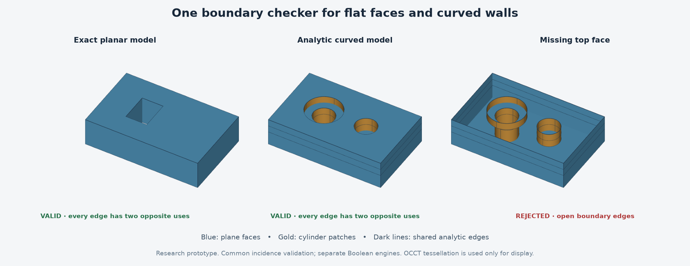

# Shared boundary topology results — 2026-10-12

The planar and curved prototypes now produce one common boundary representation. Flat faces,
cylindrical wall patches, analytic edges and vertices can be inspected and checked through the
same API. This is a geometry-representation milestone, not a unified Boolean engine or a full app.

## Changes
- Added immutable vertex, edge, oriented-edge-use, face-loop, surface and shell structures.
- Preserved exact rational planar coordinates, including a 1e-30-thick test solid.
- Kept curved geometry analytic; circular walls use patches spanning at most 90 degrees.
- Matched edges after splitting at shared vertices, including layer transitions and hole rims.
- Added analytic cap-hole assignment and common connectivity/orientation checks.
- Integrated topology validation with the existing document's rebuild and save/reload path.
- Kept all Boolean algorithms in their original backends; mixed-backend operations still fail explicitly.

## Verification
19 new test methods passed. Full dependency-free runner passed 104 test executions
(14 baseline methods run in two separate suites). Positive tests exercise planar and curved
fixtures; damaged-input tests remove or duplicate faces, reverse an edge, corrupt references,
alter a cylinder radius and insert nonfinite coordinates. Point-touching shells are rejected
because their vertex links are disconnected.

54 OCCT comparisons passed using geometry reconstructed from the common representation.
All reference and sewn converted shapes passed their OCCT validity checks. Connected shell
counts agreed. Maximum area error: 6.821210263296962e-13 mm².
Maximum signed-volume error: 2.7284841053187847e-12 mm³.
Across 16,045 bidirectional sample evaluations, maximum surface distance:
4.021398830883446e-15 mm. Sampling is not a global-equivalence proof.

An initial cylindrical export failed because the direct 3D-wire constructor supplied no
parametric curves on the cylinder: all four edge CurveOnSurface queries returned null.
The adapter now verifies each wall's rectangular angle/z domain and uses OCCT's bounded
cylinder-face constructor. Native sewing can rebuild subdivisions; edge IDs are not compared.
The core topology and Boolean modeling do not call OCCT.

The illustration was rendered from the actual common representation and visually inspected.
The right panel removes the top face from the middle model; the checker reports open edges.

## Limits and next engineering question
The checker establishes incidence, orientation and basic surface consistency for the supported
generated models. It does not test arbitrary face intersections, shell nesting, full geometric
self-intersections or all malformed public inputs. Feature and topology identifiers are not
stable face names across edits. There are extra coplanar/co-cylindrical patches, and exact
planar and floating-point curved geometry still use different numerical policies.

The next useful step is to test a deliberately bounded operation that uses this common
boundary directly, while retaining independent reference comparisons. General tilted
cylinder intersections and fillets remain substantially larger tasks.

Source: experiments/2026-10-12-shared-topology in the private
[GitHub repository](https://github.com/ichen27/fusion-recreation).
