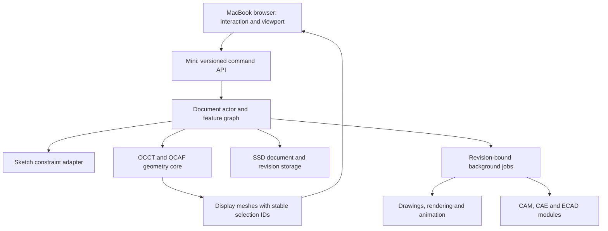

# Fusion recreation — full-product design specification

Date: 2026-10-11  
Status: architecture approved by Ivan on 2026-10-11; foundation implementation plan awaiting review. No recreation product code exists yet.
Reference: installed Autodesk Fusion 2705.1.15, bundle com.autodesk.fusion360.  
Working project name: fusion-recreation (an internal identifier, not a public brand).

## 1. Intent and success

Ivan explicitly requested recreation of the entire application after the initial sketch/extrusion proposal. Full application coverage remains the target. A smaller first milestone is the starting dependency, not a replacement for that request.

Build an independently runnable CAD/CAM/CAE/ECAD application whose supported workflows can be compared against a frozen Fusion reference. Development and engineering computation run on the Mac mini SSD. The MacBook is the interactive client. Functional equivalence, interaction fidelity, file interoperability and numerical agreement are distinct dimensions and will be measured separately.

Architecture defaults approved on 2026-10-11: a browser interface, local display rendering, a mini-hosted authoritative modeling service, single-user operation first, and implementation using established open-source foundations. No timeline, budget, team size, or complete parity claim has been established.

Completion means all agreed reference capabilities have implementations and passing evidence-linked acceptance tests, including cross-workspace changes and recovery. Neither a similar interface nor an advertised command count establishes completion.

## 2. What the inspection establishes

The installed bundle occupies approximately 11 GB. Its Contents tree contains 98,365 regular, non-symlink files; the inventory identified 1,357 .dylib/.so files. These counts include packaged dependencies and duplicates, not independent product features.

Thirty-two selected CommandDefinitions XML files yielded 1,142 declaration records and 1,084 distinct CommandDefinition identifiers. The declarations span Fusion, electronics, drawing/document, simulation, animation, mesh and volumetric modules. Both selected CAM command-definition files are empty. This census is explicitly incomplete.

Three packaged adsk Python modules contain 1,778 class definitions: core 369, fusion 1,051 and cam 358. API surface and command declarations are discovery clues; neither proves behavior, availability or entitlement.

REA inspected the ARM64 executable slice and Ghidra recovered the entrypoint's pseudocode. Calls and names indicate application creation, startup logging, optional parent-process waiting, safe-mode handling and initialization. This is a static interpretation of one routine, not observed runtime behavior and not recovered modeling algorithms.

Research evidence and limitations are documented in fusion-research-findings.md. Original executable bytes and copied vendor resources remain private in the SSD research area; they are not implementation assets.

## 3. Scope and parity matrix

All rows remain in the target. None is implemented by this project.

| Domain | Target capabilities | Acceptance evidence | Dependency wave |
|---|---|---|---|
| Application shell | Workspaces, document tabs, model browser, contextual commands, selection, inspect/measure, camera navigation, preferences, units, command search and help | Task-based interaction checks; keyboard/focus tests; persistent settings; no inert controls presented as working | 1 onward |
| Sketching | 2D and 3D geometry, construction entities, dimensions, constraints, profiles, projection and edit tools | Under/fully/over-constrained corpus; residuals and degrees of freedom; dragging and conflicting-dimension recovery | 1–2 |
| Solids and history | Extrude, revolve, loft, sweep, Boolean operations, holes, fillet/chamfer, shell, draft, patterns, direct edits, parameters, rollback and suppression | Valid B-rep, physical measurements, parameter sweeps, reference preservation, undo/redo and save/reopen | 1–2 |
| Surfaces and freeform | Surface construction, trim/extend/stitch, offsets, continuity inspection, subdivision/freeform editing and solid conversion | Surface deviation and continuity checks; orientation; closed conversion; editable controls | 3 |
| Mesh | Import, tessellation, inspection, repair, reduction, segmentation and mesh/solid conversion | Manifoldness, boundaries, normals and quantified geometric deviation on clean and defective fixtures | 3 |
| Sheet metal | Rules, thickness, flanges, bends, reliefs, unfolding/refolding, flat patterns and DXF | Developed dimensions and bend allowances; propagation from folded model; flat-pattern-specific edits | 3 |
| Assemblies/configurations | Components and occurrences, external references, joints/constraints, motion, interference and variants | Degrees of freedom, trajectory and limit tests; repeated/nested parts; changed-reference recovery | 3 |
| Drawings/PMI | Associative views, sections/details, dimensions/tolerances, annotations, sheets/templates, parts lists and model annotations | Scale and geometric comparisons, correct measurements, BOM quantities, model-change propagation and exported documents | 4 |
| Rendering/animation | Materials, appearances, textures/decals, lighting, cameras, image jobs, storyboard transforms, visibility and callouts | Persisted material mapping; repeatable camera/scene fixtures; timed animation endpoints and image-quality criteria | 4 |
| CAM | Setups, stock/fixtures, tool libraries, milling/drilling/turning/cutting, probing/inspection, multi-axis strategies, machine simulation and NC posts | Removed-stock and gouge tests; fixture/machine collision checks; independent post interpretation and machine limits | 5 |
| Nesting/additive | Arrangement/nesting, sheet utilization, build preparation, slicing, supports, process profiles and machine outputs | No-overlap nesting; layer/contour reconstruction; build-volume and support checks; process-specific validation | 5 |
| Simulation/generative | Materials, mesh, contacts, loads/conditions, structural/thermal/modal and other study types, optimization and results | Analytic benchmarks, convergence, unit/equilibrium checks, provenance and feasibility of generated designs | 5–6 |
| Electronics | Libraries, schematics, netlists, PCB layout/routing, rule checks, circuit simulation, manufacturing output and mechanical synchronization | Connectivity preservation; seeded violations; electrical benchmark curves; reconstructed board layers and component placement | 5 |
| Data/collaboration | Projects, files, versions, referenced designs, sharing, permissions, concurrent editing, BOM/properties and recovery | Conflict/reconnect tests; atomic version history; permission enforcement; reproducible historical retrieval | 1 foundations, 6 full workflows |
| Automation/interchange | Scripting, add-ins/events, stable object model, APIs, native project persistence and CAD/mesh/drawing exchange | API conformance fixtures, schema migration, round trips with explicit units/placement/geometry/metadata loss reporting | 1 foundations, 6 breadth |
| Advanced assistance | Automated constraints, feature assistance and optimization workflows present in the reference/capability tier | Task-specific correctness and reproducibility; explicit uncertainty and measured failure cases | 6 |

Reference sources: [sketches](https://help.autodesk.com/view/fusion360/ENU/?contextId=SKT-3D-SKETCH), [modeling modes](https://help.autodesk.com/view/fusion360/ENU/?contextId=DESIGN_HISTORY), [parameters](https://help.autodesk.com/cloudhelp/ENU/Fusion-Model/files/SLD-MODIFY-PARAMETERS.htm), [surface construction](https://help.autodesk.com/cloudhelp/ENU/Fusion-Patch/files/SFC-CREATE-SURFACE-FROM-SKETCH.htm), [mesh](https://help.autodesk.com/view/fusion360/ENU/?contextId=MESH-CREATE-TOOLS), [flat patterns](https://help.autodesk.com/cloudhelp/ENU/Fusion-Sheet-Metal/files/GUID-121F6E58-0459-4552-85EF-319F44324AE6.htm), [assemblies](https://help.autodesk.com/cloudhelp/ENU/Fusion-Assemble/files/ASM-JOINTS.htm), [drawings](https://help.autodesk.com/view/fusion360/ENU/?contextId=DRAWINGS-CREATE-FROM-DESIGN-CMD), [rendering](https://help.autodesk.com/cloudhelp/ENU/Fusion-Render/files/GUID-AFA42779-F9EB-4586-9DC2-A658646C0294.htm), [animation](https://help.autodesk.com/cloudhelp/ENU/Fusion-Animate/files/GUID-25E6D2E0-8057-4BFF-93B3-E7AEE2C4404A.htm), [manufacturing](https://help.autodesk.com/view/fusion360/ENU/?contextId=MFG-REF-SIMULATION), [extensions](https://help.autodesk.com/cloudhelp/ENU/Fusion-Extensions/files/GUID-EEE56836-C03A-4B10-A51C-A6203CF46AC4.htm), [electronics](https://help.autodesk.com/view/fusion360/ENU/?contextId=ECD-OVERVIEW), [collaboration](https://help.autodesk.com/view/fusion360/ENU/?contextId=TC-COLLAB-EDIT), [API](https://aps.autodesk.com/developer/overview/autodesk-fusion-api).

The online catalog evolves independently of the installed build. Newer release notes, staged cloud rollouts and extension-only functions need separate baseline labels. Fusion Manage is a separately documented PLM product; its integration boundary will be recorded, not silently equated with Fusion itself. Offline files cannot reveal server implementations. Equivalent service behavior needs its own design and authorized reference observations.

## 4. Architecture alternatives and recommendation

**Recommended: an independent application on Open CASCADE Technology (OCCT).** A mini-hosted C++ service owns geometry, documents, recomputation and jobs. A TypeScript browser client owns interaction and rendering. Use OCAF for document/attribute/transaction infrastructure and shape evolution, with an explicit product feature graph above it. Evaluate the actual planeGCS integration in the first technical gate. This route supports a distinct Fusion-like workflow but has the greatest application-engineering burden.

**Alternative: extend FreeCAD.** FreeCAD already provides parametric modeling, sketch constraints, document infrastructure and a Python API. A fork or extension is the lower-risk path to broad useful CAD sooner, but requires adapting its document/workbench semantics and maintaining the integration. It does not supply complete Fusion-equivalent manufacturing, electronics or cloud behavior by itself. [FreeCAD](https://github.com/FreeCAD/FreeCAD).

**Alternative: a Fusion add-in.** Useful as a reference harness or automation experiment, but continued dependence on Fusion means it does not meet the independent recreation target. [Autodesk API overview](https://aps.autodesk.com/developer/overview/autodesk-fusion-api).

OCCT provides modeling algorithms; OCAF supplies reusable document mechanisms. Product-specific modeling commands, feature semantics, UI, constraints and multi-domain workflows still require implementation. [OCCT modeling algorithms](https://occt3d.com/dev/doc/overview/html/occt_user_guides__modeling_algos.html), [OCAF](https://occt3d.com/dev/doc/overview/html/occt_user_guides__ocaf.html).

The recommendation is a proposed choice, not a proven integration. Gate 0 must disprove it early if the solver, persistence or topology behavior cannot satisfy the foundation tests. Do not hide a failed technical gate behind interface work.

## 5. Component boundaries

A document actor serializes accepted changes to one document. Native geometry work runs in a bounded worker process so a kernel failure does not destroy the service. The initial release permits one writer per document; later collaboration builds on explicit revisions instead of accidental shared mutable state.

Commands contain document ID, expected revision, transaction ID, operation and typed parameters. Responses contain the committed revision, affected feature IDs, diagnostics and revision-tagged display changes. Repeating a transaction must not create another feature. Stale revisions return a conflict. Preview jobs are cancellable and never commit themselves.

The browser may render and move the camera locally; engineering computation remains on the mini. Browser rendering is an explicit assumption about the light-client rule. If all rendering must also occur on the mini, this becomes a streamed-display architecture and must be reviewed separately.

## 6. Document and geometry contracts

Persist stable IDs for documents, parts, occurrences, features, sketch entities and constraints. Store physical units explicitly. The feature dependency graph records inputs, expressions, suppression and result status. Reject cycles. Recompute affected descendants in order and report the first failing feature.

Use OCAF transactions and an application command log with clearly defined ownership: one committed command equals one user undo step, including parameter edits affecting many descendants. Store a versioned manifest and native document payload atomically. Geometry caches are disposable and tagged with the generating revision and engine version. Migration failures preserve the original file.

A mesh triangle index or face number is never a durable selection. Track generated/modified/deleted topology, feature provenance and semantic selections. Geometric fallback matching must expose ambiguity. Deleted or split geometry can invalidate a reference; show a repairable failure rather than silently selecting another face. Topological naming remains a primary risk even in mature CAD systems. [FreeCAD topology discussion](https://github.com/FreeCAD/FreeCAD-documentation/blob/main/wiki/Topological_naming_problem.md).

The sketch adapter owns entity IDs, dimensional expressions, solving/diagnostics, construction geometry and closed-profile validation. Its solver must expose free degrees of freedom and conflicting/redundant constraints. The inspected planeGCS interface provides relevant hooks, but integration and numerical behavior must be tested. [planeGCS interface](https://github.com/FreeCAD/FreeCAD/blob/main/src/Mod/Sketcher/App/planegcs/GCS.h).

Part definitions and assembly occurrences are separate. XDE/STEP support exchanges assembly structure and attributes; it does not replace joint semantics. STEP import initially produces geometry and occurrences, not reconstructed original feature history. STL exports triangulated geometry and is never the native editable format. [XDE](https://occt3d.com/dev/doc/overview/html/occt_user_guides__xde.html).

## 7. Engineering and service domains

CAM, CAE, electronics, drawings and rendering consume explicit document revisions and return revision-bound results. A CAD edit invalidates stale downstream results visibly. Each domain retains its own parameters, solver/tool versions and dependency references.

CAM output requires machine/post-specific validation; a plausible toolpath preview is insufficient. CAE requires mesh convergence and reference solutions; a colored stress plot is insufficient. ECAD requires net connectivity and manufacturing-layer validation; a board-shaped mesh is insufficient.

Heavy jobs support cancellation, progress and resumable metadata. User documents are local-first on the SSD in the first build. Cloud collaboration is a later capability with identity, authorization, revision conflicts, recovery and audit history designed from the outset. No Autodesk credentials or backend dependency is required for the proposed standalone application.

Native Fusion document/history interchange is an unresolved compatibility research target. It is not promised from recognizing an extension or importing a shape. Unsupported semantics require an explicit loss report; no silent flattening presented as preserved history.

## 8. Delivery waves and exit gates

### Gate 0 — viable foundation

Demonstrate the same reference workflow against the proposed kernel/solver and evaluate FreeCAD as a fallback comparison. Prove sketch solving, solid creation, topology-aware downstream selection, parameter recomputation, undo/redo, persistence and STEP exchange. Record dependency versions and reproducible build commands. If the custom foundation fails, revisit the architecture before broad UI implementation.

### Wave 1 — first complete modeling workflow

A user creates a dimensioned rectangle and a circle, extrudes a body, cuts a hole, changes dimensions, edits history, undoes/redoes, saves/reopens, and exports valid STEP/STL. The interface includes an operational model tree, viewport, parameter controls and timeline. All actions must affect authoritative geometry, not only a rendered mesh.

### Wave 2 — general authoring

Expand sketch geometry/constraints, solid features, direct edits, expressions, history operations and repair diagnostics. Add unit, import, corruption/recovery and performance coverage. This wave exits only with a useful reference corpus rather than a collection of isolated happy-path commands.

### Wave 3 — geometric breadth and assemblies

Add surfaces/freeform, meshes, sheet metal, assemblies and configurations. Subdivision/T-spline behavior is an independent implementation risk; generic smooth meshes are not automatically equivalent. Preserve cross-feature references through edit/delete/suppress cases.

### Wave 4 — derived output

Build associative drawings/PMI, BOMs, rendering and animation against the same document revisions. Validate downstream updates when underlying dimensions or occurrences change.

### Wave 5 — engineering branches

Deliver manufacturing/nesting/additive, electronics and simulation as separate tested subsystems. Their development may proceed independently once shared document/geometry contracts are stable. A branch's existence does not establish readiness for physical production.

### Wave 6 — full integration and coverage closure

Add collaboration breadth, extension-level functions, automation compatibility, translators and advanced assistance. Execute multi-workspace changes from CAD through manufacturing, drawings, analysis and board integration, then recover old versions. Resolve every baseline row as verified, changed-by-agreement, or blocked with a reason.

No dates or percentage-complete estimate are asserted. A reliable estimate requires Gate 0 measurements and a command-level backlog with acceptance fixtures.

## 9. First acceptance corpus

1. Rectangle 40 × 20 mm, extrusion 10 mm: volume 8,000 mm³; changing width to 50 yields 10,000 mm³.
2. A centered radius-3 mm through-hole changes volume by 90π mm³ at 10 mm depth. Recompute after width changes while preserving centering.
3. Change an independent parameter and confirm an unrelated feature remains unchanged.
4. Add conflicting dimensions: report the conflict and preserve a recoverable sketch.
5. Extrude an open or self-intersecting profile: reject with a specific diagnostic.
6. Undo and redo a multi-descendant parameter update as one transaction.
7. Save/reopen and compare feature parameters, identities, units and resulting geometry.
8. Round-trip STEP and compare geometry/placement; report absent feature history.
9. Export STL and check units, watertightness and configured tessellation tolerance.
10. Split or remove a referenced face: preserve an unambiguous reference or surface a broken reference; never silently reattach.
11. Disconnect during a pending preview: no unintended committed operation.
12. Re-send a transaction or submit a stale revision: no duplicate feature or lost update.
13. Cancel a kernel job and reopen the last committed document.
14. Compare outcomes against explicitly constructed reference fixtures in Fusion without modifying unrelated user designs.

For simple analytic millimeter fixtures, start with volume tolerance max(1e-6 mm³, 1e-8 relative). Treat this as a proposed acceptance threshold to validate against numerical conditioning; do not silently loosen it. General geometry uses scale-aware distance/angle tolerances stated per fixture. Topology/semantic equivalence is evaluated separately from geometric distance.

## 10. Evidence and release discipline

For each capability, retain reference version, command/workflow, starting model, inputs, expected result, output measurements, implementation test, observed limitations and status. Use statuses: inventoried, behavior-observed, specified, implemented, verified, unsupported. Do not collapse these into a single done flag.

Reverse engineering follows concrete behavioral questions. Reuse documented API and UI behavior when they establish the answer; use focused REA disassembly where they do not. Recovered pseudocode informs understanding but is not a production source tree. Create original implementation code and interface assets.

Keep the inspected vendor binaries and research artifacts out of any public source repository. The project should pin dependencies and review their actual distribution terms; no license compatibility conclusion is made here. OCCT and FreeCAD license documentation are inputs to that review, not a substitute for it.

Ivan approved the independent browser-plus-mini OCCT architecture on 2026-10-11. The foundation implementation plan is docs/superpowers/plans/2026-10-11-fusion-foundation.md. Gate 0 still tests integration viability; approval is not evidence that the kernel/solver or complete app works.
