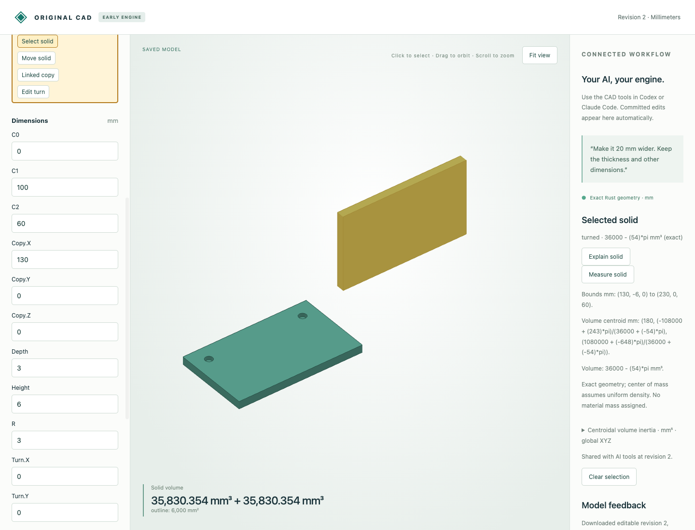

# Symbolic measurements for circular and perforated solids

Measure solid and `cad_measure` now include circular stock, polygon plates with circular holes, blind pockets and their exact placements. Bounds remain rational; centroids and centroidal volume inertia can be rational functions of π. Expressions use integers, parentheses, `+`, `-`, `*`, `/` and `pi`. They are output values, not newly accepted parameter expressions.

The engine integrates the polygon or circular stock and subtracts exact cylinder moments over each hole's depth interval. First moments and raw second moments are linear in π. Centering produces a polynomial of degree at most two over the linear volume expression; exact polynomial division cancels factors where possible. Placed centroids and bounds transform exactly, while inertia follows `R I Rᵀ`. No approximate π defines the native measurement.

## Actual browser and MCP workflow

[Editable input](input.cad.json) contains a 100×60×6 mm plate with two radius-3 blind holes centered at `(12,12)` and `(88,12)`, initially 2 mm deep. A linked copy is placed at x=130 then turned 90° around global X. [Six browser HTTP calls](browser-recording.json) measure the source and placed copy, preview/save depth 3 and remeasure the placed copy. [Six actual MCP calls](mcp-recording.json) independently measure, preview/save the same depth edit and reject a stale measurement revision. No new inference run is claimed.

[Browser edited project](browser-deeper.cad.json) and [MCP edited project](mcp-deeper.cad.json) retain their independent transaction histories. Each part's volume changes from `36000 − 36π` to `36000 − 54π` mm³. Measurement calls leave native history unchanged; only the explicit commit writes. The source centroid moves away from the material removed at the holes, including in height. The placed copy's centroid and inertia follow its orientation.



## Independent reference corpus

[Measured comparison report](independent-comparison.json) contains exact native values, independently constructed OCCT centroids/tensors and error measurements for all fifteen cases. As in the [planar measurement corpus](../measurements/README.md), independent solids are integrated separately and aggregated with the parallel-axis theorem. Numerical tolerances are 1e-7 mm³ volume, 1e-8 mm centroid and 1e-6 mm⁵ per tensor entry.

| Part | Source | Fractional placement | Moved + Y quarter-turn |
|---|---|---|---|
| Cylinder | [model](cylinder.model.json) | [model](cylinder_placed.model.json) | [model](cylinder_turned.model.json) |
| Through-hole flange | [model](flange.model.json) | [model](flange_placed.model.json) | [model](flange_turned.model.json) |
| Blind-pocket flange | [model](blind_flange.model.json) | [model](blind_flange_placed.model.json) | [model](blind_flange_turned.model.json) |
| Through-hole plate | [model](plate.model.json) | [model](plate_placed.model.json) | [model](plate_turned.model.json) |
| Blind-hole plate | [model](blind_plate.model.json) | [model](blind_plate_placed.model.json) | [model](blind_plate_turned.model.json) |

Closed-form tests check cylinder inertia and common-π cancellation. Independent removed-cylinder first moments check blind flange centroid. Four exact rational substitutions verify bounded symbolic identities for asymmetric blind-hole centroids, cross inertia and rigid covariance, beyond agreement at rounded π. Tests also cover both profile windings, all axes/quarter turns, rational pivots, placed bounds and translation-invariant centroidal tensors.

## Reproduce

After [build/setup](../../../tools/ai-cad/README.md), run:

```sh
python3 -m unittest discover -s tools/ai-cad -p test_analytic_measurements.py -v
python3 tools/ai-cad/verify_analytic_measurements.py
mkdir -p work
cp examples/ai-cad/analytic-measurements/input.cad.json work/measured-parts.cad.json
python3 tools/ai-cad/viewer.py --store work/measured-parts.cad.json
```

Select a part and choose Measure solid. Run `verify_analytic_measurements_mcp.py` with `tools/ai-cad/requirements.lock`, and `verify_analytic_measurements_reference.py` with `tools/ai-cad/step-requirements.txt`; optional `--write` regenerates synthetic artifacts.

The tensor is geometric volume inertia in mm⁵ about the volume centroid, in global axes. Physical center of mass requires uniform density; mass inertia requires multiplying by a specified density. No material or mass is assigned. Existing coefficient/model/time limits apply. No surface-area, principal-axis, clearance, collision or automatic union of separate bodies is provided. This extends measurement of existing analytic families; it does not introduce new curved Boolean geometry.
