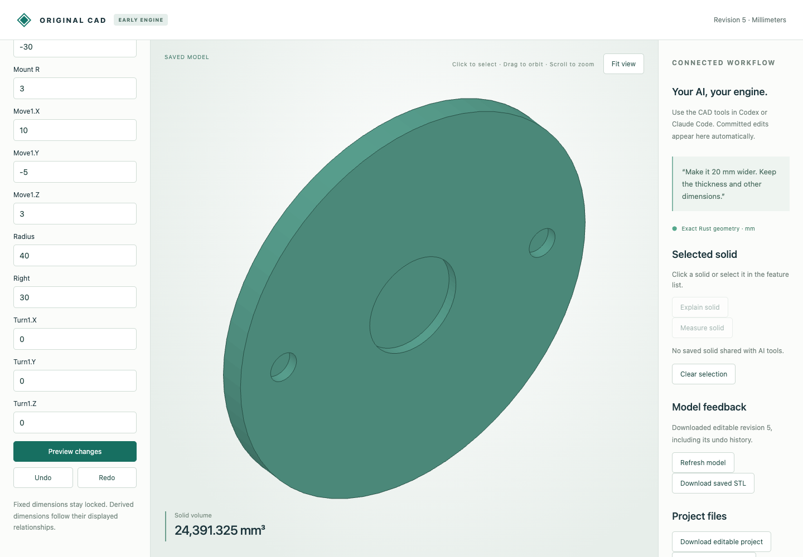

# Exact placement of circular and perforated solids

Move, quarter-turn and linked-copy features now accept analytic circular stock and through/blind-hole parts. Local circles, cylinder walls and hole depths stay analytic. An optional exact placement stores signed-axis orientation and rational origin: `world = axes × local + origin`. Existing planar placement results keep their representation.

## Actual browser and MCP workflow

The synthetic [input flange](mcp-input.cad.json) has outer radius 40 mm, height 5 mm, a central radius-10 pocket and two radius-3 pockets, all initially 2 mm deep. The browser moves it by `(10,-5,3)`, turns it 90° about global X, deepens the pockets to 3 mm, rejects depth 5, then undoes the depth edit. [Twelve actual HTTP calls](browser-recording.json) preserve preview, commit, rejection and undo responses. An off-screen automation click initially sent no preview request; the recorded depth edit was performed after scrolling the control into view.

| Editable native download | Revision | Exact volume mm³ | Pocket depth mm |
|---|---:|---:|---:|
| [Moved](browser-moved.cad.json) | 2 | 7764π | 2 |
| [Turned](browser-turned.cad.json) | 3 | 7764π | 2 |
| [Deeper](browser-deeper.cad.json) | 4 | 7646π | 3 |
| [Undo](browser-undo.cad.json) | 5 | 7764π | 2 |

[Downloaded STL](browser-deeper.stl) is a closed oriented mesh with blind-hole floors at world y=-5. Its world bounds agree with `(-30,-8,-45)`–`(50,-3,35)` within the documented circular tessellation error. The test checks the expected 128-segment polygonal volume, not exact circular volume. Native documents retain analytic geometry and editable history; STL is approximate geometry only.



[Back-side capture at the deeper stage](browser-deeper.png) shows the saved revision before rejection/undo. [Seven actual MCP calls](mcp-recording.json) independently create the [source](mcp-input.cad.json), [move](mcp-moved.cad.json), [turn](mcp-turned.cad.json), and reject invalid depth without saving. These are real typed transport calls without a new inference session.

## Independent analytic STEP comparison

The oracle independently constructs circular stock and hole cylinders, performs reference subtraction, then applies the requested transform. Native modeling does not use OCCT. STEP translates local analytic surfaces and applies the exact placement through its floating adapter. [Measured results](step-comparison.json) check valid solids, volume, area, both directed residual volumes, cylinder count and cylinder-axis orientation (volume/area tolerance 1e-6 in their corresponding mm units).

| Case | Typed source | Finished STEP |
|---|---|---|
| Moved cylinder | [model](moved_cylinder.model.json) | [STEP](moved_cylinder.step) |
| Turned flange with through-holes | [model](turned_flange.model.json) | [STEP](turned_flange.step) |
| Turned blind-pocket flange | [model](turned_blind_flange.model.json) | [STEP](turned_blind_flange.step) |
| Turned perforated plate | [model](turned_plate.model.json) | [STEP](turned_plate.step) |
| Turned blind-pocket plate | [model](turned_blind_plate.model.json) | [STEP](turned_blind_plate.step) |
| Linked flange | [model](linked_flange.model.json) | [STEP](linked_flange.step) |

## Reproduce

After [build/setup](../../../tools/ai-cad/README.md), run:

```sh
python3 -m unittest discover -s tools/ai-cad -p test_analytic_placement.py -v
node --test tools/ai-cad/test_rotation_editor.mjs
python3 tools/ai-cad/verify_analytic_placement.py
mkdir -p work
cp examples/ai-cad/analytic-placement/browser-undo.cad.json work/placed-flange.cad.json
python3 tools/ai-cad/viewer.py --store work/placed-flange.cad.json
```

Run `verify_analytic_placement_mcp.py` with `tools/ai-cad/requirements.lock` and `verify_analytic_placement_export.py` with `tools/ai-cad/step-requirements.txt`. Optional `--write` regenerates their synthetic artifact sets. Tests cover all three axes/quarter turns, fractional pivots/offsets, inverse composition, unchanged analytic geometry and radial error, linked depth propagation, invalid edits and computed-placement rational limits.

Offsets/pivots retain ±1000000 mm input limits; composed origins are bounded to 1024-bit rationals. Orientation is an internally constructed proper signed-permutation matrix. Arbitrary angles, scaling/mirroring, curved Booleans/cuts and measurements of analytic curved parts remain unsupported. Add/edit holes on original stock before placement. No source geometry is approximated as a polygon to enable native operations. Rendering/export may reject scales where floating coordinates collapse; saved exact geometry remains valid.

Subsequent support: [symbolic analytic measurements](../analytic-measurements/README.md) now includes circular/perforated solids and their exact placements. Earlier curved-measurement exclusions describe the original checkpoint.
