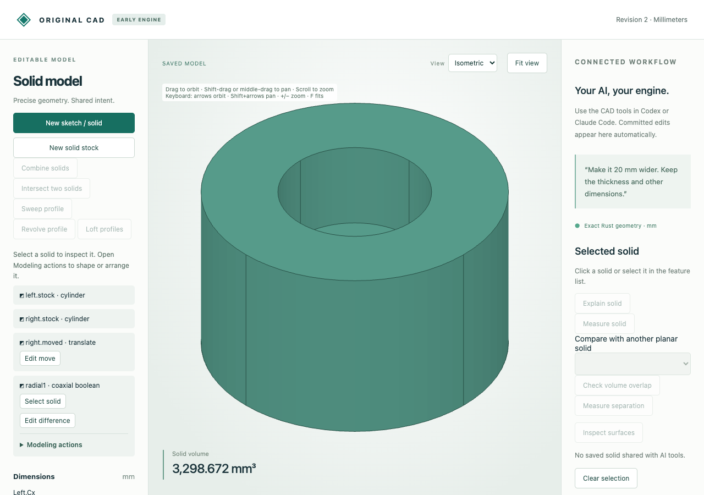

# Exact coaxial joins and cuts

Combine analytic round solids on one shared axis. The source dimensions and operation
remain editable. Convex and concave radial sections support stepped unions, blind
recesses, through-bores and conical walls with exact native surfaces and moments.



Import [the source parts](browser-source.cad.json), choose **Combine solids → Coaxial
round solids**, and select **Difference**. Preview/save cuts the smaller cylinder
from the larger one, leaving **1050π mm³** with a flat blind floor. Use **Edit
difference** to switch to **Union**: volume becomes **1250π mm³**. A perpendicular
source movement of1 mm rejects because the axes no longer coincide. Undo restores
the blind cut. The MCP demonstration instead changes the tool radius from5 to6 mm,
leaving **984π mm³**, then rejects a misalignment and undoes that edit.

| Artifact | Purpose |
|---|---|
| [Source](browser-source.cad.json), [blind cut](browser-created.cad.json) | Editable original solids and saved subtraction |
| [Union](browser-edited.cad.json), [download](browser-download.cad.json), [STL](browser-edited.stl), [viewport](union.png) | Saved operation replacement and actual exports |
| [Undo](browser-undo.cad.json) | Restored cut with retained history |
| [Browser recording](browser-recording.json), [audit](browser-audit.json), [runtime](browser-runtime.json) | Nine actual requests/job replies, rejected draft and worker report |
| [MCP recording](mcp-recording.json) | Ten typed stdio create/measure/topology/select/edit/reject/undo calls |
| [MCP created](mcp-created.cad.json), [edited](mcp-edited.cad.json), [undo](mcp-undo.cad.json) | Native radius-edit checkpoints |
| [Independent comparisons](independent-comparison.json) | Fourteen source-built reference Booleans, two STEP adapters and exact moments |
| `*.model.json`, `*-stock.step`, `*-shared.step` | Editable reference sources and28 STEP exports/readbacks |

Reference names: `blind_cut`, `union`, `intersection`, `through_bore`, `stepped_cut`,
`stepped_union`, `face_join`, `conical_cut`, `fractional`, `nested`, `axis_x`,
`opposite`, `translated`, `linked`. STEP exchanges boundary geometry without native
feature history. Production uses the original exact planar-cell engine on radial
sections; external solid modeling is confined to independent verification.

After the [quickstart](../../../tools/ai-cad/README.md), run:

```sh
python3 -m unittest discover -s tools/ai-cad -p test_coaxial_boolean.py -v
node --test tools/ai-cad/test_boolean_editor.mjs
python3 tools/ai-cad/verify_coaxial_boolean.py
python3 tools/ai-cad/verify_coaxial_boolean_mcp.py
python3 tools/ai-cad/verify_coaxial_boolean_export.py
```

MCP requires `tools/ai-cad/requirements.lock`; comparisons require
`tools/ai-cad/step-requirements.txt`. The last two scripts accept `--write`.
Browser replay checks retained actual responses, not a new browser session. Exact
native data compares strictly; disposable display floats allow1e-13 differences.
The downloaded 128-segment union STL has volume
`1250 × 128 × sin(2π/128) / 2`, rather than exact1250π.

Limits: one exactly shared coordinate-axis line; one connected result region in
radius/height with no interior contour holes and at most32 simplified corners.
If it touches the axis, the result needs one connected axis edge with flat ends.
Disconnected regions, enclosed cavities, multiple axis contacts, nonmanifold joins,
empty material and construction geometry beyond the existing cell/boundary budgets
reject. Generated surface references are revision-only. Floating STEP/display
precision remains stricter than native exact geometry; see the
[revolution adapter limits](../revolution/README.md). No general noncoaxial curved
Boolean or implicit topology repair is claimed.
