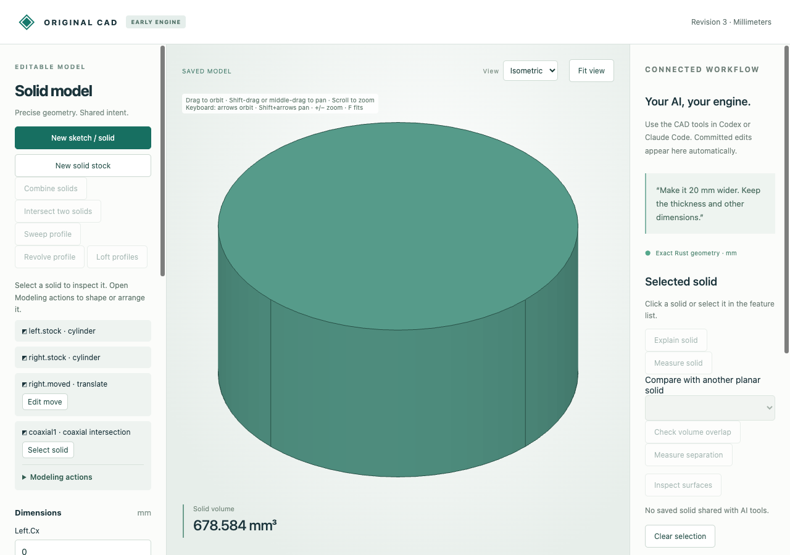

# Exact coaxial curved-solid intersections

Keep common volume of round parts that share exactly the same axis. Cylinders,
frusta and convex radius/axial profile sections retain exact analytic surfaces
and moments. Hollow ring sections, translations, coordinate quarter-turns and
opposite axial directions are supported.



Import [the two source parts](browser-source.cad.json), choose **Intersect two
solids**, and select **Coaxial round solids**. The smaller cylinder overlaps its
larger neighbor from Z=6 to12 mm; preview/save gives **150π mm³**. Change Right.Radius
from5 to6 mm: the result becomes **216π mm³**. Moving its source to Z=20 rejects
because no common volume remains. Undo restores the earlier radius and intersection.

| Artifact | Purpose |
|---|---|
| [Source](browser-source.cad.json), [created](browser-created.cad.json) | Editable inputs and saved intersection |
| [Edited](browser-edited.cad.json), [download](browser-download.cad.json), [STL](browser-edited.stl) | Actual saved/downloaded source edit and closed outward mesh |
| [Undo](browser-undo.cad.json) | Restored shape and retained native history |
| [Browser recording](browser-recording.json), [audit](browser-audit.json), [runtime](browser-runtime.json) | Nine actual requests/job replies, rejected edit and worker report |
| [MCP recording](mcp-recording.json) | Ten typed stdio calls: create, measure, inspect/select surface, guarded edit, reject, undo |
| [MCP created](mcp-created.cad.json), [edited](mcp-edited.cad.json), [undo](mcp-undo.cad.json) | Native checkpoints |
| [Independent comparisons](independent-comparison.json) | Twelve independent curved intersections, two export adapters and exact moments |
| `*.model.json`, `*-stock.step`, `*-shared.step` | Editable source models and24 actual STEP readbacks |

Reference names: `cylinders`, `taper`, `rings`, `conical_ring`, `opposite`,
`fractional`, `nested`, `axis_x`, `axis_y`, `translated`, `rotated`, `linked`.
STEP opens in a STEP-capable application without native feature history. The
reference engine builds/intersects source solids only in verification; production
modeling clips the radial section exactly and uses no external Boolean fallback.

After the [quickstart](../../../tools/ai-cad/README.md), run:

```sh
python3 -m unittest discover -s tools/ai-cad -p test_coaxial.py -v
node --test tools/ai-cad/test_intersection_editor.mjs
python3 tools/ai-cad/verify_coaxial.py
python3 tools/ai-cad/verify_coaxial_mcp.py
python3 tools/ai-cad/verify_coaxial_export.py
```

MCP requires `tools/ai-cad/requirements.lock`; STEP comparison requires
`tools/ai-cad/step-requirements.txt`. The last two scripts accept `--write`.
Browser replay checks retained actual responses, not a new browser session. Exact
native data compares strictly; disposable display floats allow1e-13 differences.
The 128-segment STL has volume `216 × 128 × sin(2π/128) / 2`, rather than exact216π.
Forty seeded taper pairs also compare against independent piecewise disk integrals,
with both operand orders, in the native tests.

Limits: strictly convex radial polygons and exactly coincident coordinate-axis
lines. Nonconvex stepped/undercut sections, perforated stock, offset/crossing axes,
zero-volume contact and results beyond32 corners reject. Axis contact retains the
single connected edge/flat-end policy. Generated surface IDs are revision-only
references. Arbitrary curved union/difference and noncoaxial intersections are not
implemented here. Floating STEP/display adapters retain stricter precision limits
than exact native geometry; see the [revolution adapter limits](../revolution/README.md).
