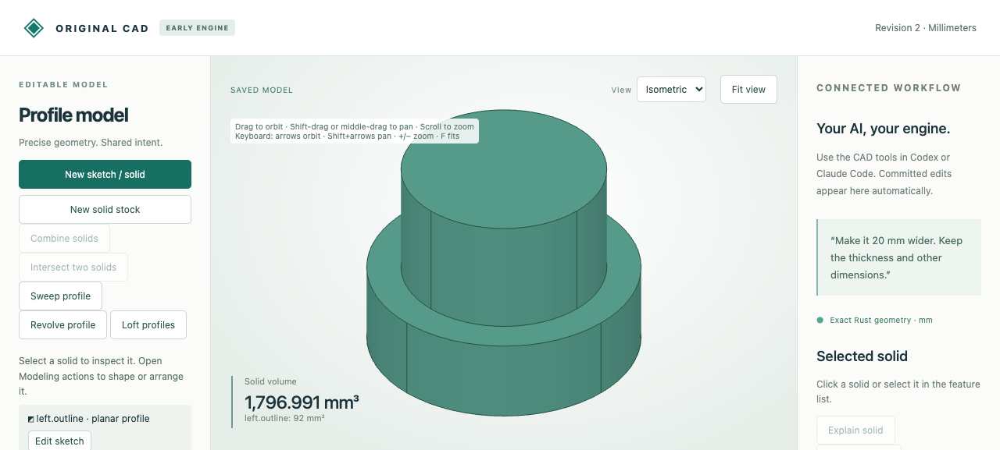

# Intersect stepped and undercut round parts

The dedicated **Intersect two solids → Coaxial round solids** operation now accepts
simple concave radial profiles, including stepped shafts and undercut rings. The
source sketches and dimensions remain editable. Convex inputs keep the previous
clipping path and recorded surface ordering.



Import [the source](browser-source.cad.json), intersect the two solids and save:
the result is **572π mm³**. Change Right.Radius from 8 to 9 mm and save to obtain
**657π mm³**. Moving Right.Move.Z to 20 rejects with `empty_solid`, retaining the
saved file. Undo restores **572π mm³**. The browser and typed MCP both complete
this workflow through the authoritative native engine.

| Artifact | Purpose |
|---|---|
| [Source](browser-source.cad.json), [created](browser-created.cad.json), [edited](browser-edited.cad.json), [undo](browser-undo.cad.json) | Editable source, intersection and native history |
| [Download](browser-download.cad.json), [STL](browser-edited.stl) | Actual browser exports of the edited part |
| [Browser recording](browser-recording.json), [audit](browser-audit.json), [runtime](browser-runtime.json) | Nine actual API/job replies, invalid draft and worker reuse |
| [MCP recording](mcp-recording.json), [created](mcp-created.cad.json), [edited](mcp-edited.cad.json), [undo](mcp-undo.cad.json) | Ten actual typed calls and native checkpoints |
| [Independent comparison](independent-comparison.json) | Eight source-built references, 16 STEP readbacks, moments and material residuals |
| `*.model.json`, `*-stock.step`, `*-shared.step` | Editable comparison sources and both boundary export adapters |

Reference cases are `stepped`, `undercut`, `both_concave`, `conical`, `opposite`,
`nested`, `axis_x` and `linked`. The undercut ring's intersection has exact volume
354π mm³ and genus one. Clipping it with a ring outside its narrow waist would
create two separate regions and rejects as `unsupported_coaxial_result`.

After the [quickstart](../../../tools/ai-cad/README.md):

```sh
python3 -m unittest discover -s tools/ai-cad -p test_coaxial.py -v
node --test tools/ai-cad/test_intersection_editor.mjs
python3 tools/ai-cad/verify_coaxial.py --concave
python3 tools/ai-cad/verify_coaxial_mcp.py --concave
python3 tools/ai-cad/verify_coaxial_export.py --concave
```

MCP needs the optional locked MCP environment; STEP comparisons need the optional
STEP environment. The last two scripts accept `--write`. Browser replay validates
retained actual responses, native history and downloaded mesh topology. Native
values compare exactly; disposable display floats allow 1e-13 round-trip variation.
The 128-segment STL volume is `657 × 128 × sin(2π/128) / 2`.

Limits: exact common coordinate-axis line, one connected result contour, at most
32 simplified corners, no enclosed radial contour holes and one flat-ended axis
edge if touching the axis. Perforated stock, branching/touching contours and empty
material reject. Generated surfaces remain revision-only. General noncoaxial
intersections and arbitrary curved trimming remain unsupported.
