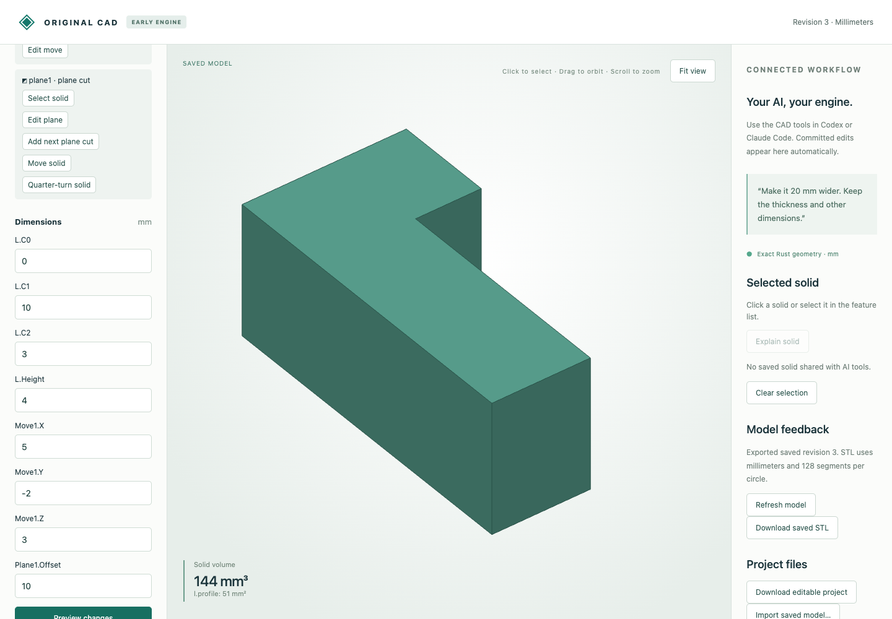

# Operations on simple concave stock

An unperforated simple XY sketch extrusion now feeds exact Boolean operations, movement, quarter turns and plane cuts. The original Rust engine decomposes the profile with rational ear clipping and builds disjoint triangular prisms. Display triangulation and OCCT do not define native geometry. Source history remains editable; existing convex results keep their serialization.

## Recorded browser and MCP workflow

The synthetic [browser input](browser-input.cad.json) is a 4 mm thick L-profile with corners `(0,0),(10,0),(10,3),(3,3),(3,10),(0,10)` and volume 204 mm³. It was prepared before browser capture. [Twelve actual HTTP calls](browser-recording.json) move it by `(5,-2,3)`, cut at x ≤ 10, edit the offset to 8, reject offset 5 because no material remains, and undo.

| Editable download | Revision | Volume mm³ |
|---|---:|---:|
| [Moved](browser-moved.cad.json) | 2 | 204 |
| [Cut](browser-cut.cad.json) | 3 | 144 |
| [Trimmed](browser-trimmed.cad.json) | 4 | 120 |
| [Undo](browser-undo.cad.json) | 5 | 144 |

[Downloaded STL](browser-cut.stl) has closed oriented topology and volume 144 mm³, with world bounds `(5,-2,3)` to `(10,8,7)` and the missing corner retained. Native files preserve features, dimensions and undo history; STL does not.



[Seven actual MCP calls](mcp-recording.json) create [L-profile and rectangular tool](mcp-inputs.cad.json), [intersect them](mcp-common.cad.json) to 28 mm³, [move the result](mcp-moved.cad.json), and reject an empty cut without changing saved bytes. These are typed transport executions without a new inference session.

## Independent STEP checks

Each oracle independently constructs the source profile in OCCT, then applies the requested operation. The exporter translates the supplied Rust boundary. [Measured comparisons](step-comparison.json) check validity, component count, volume, area and both directed residual volumes (below 1e-7 mm³).

| Case | Editable source | Finished STEP | Volume mm³ | Components |
|---|---|---|---:|---:|
| Move L-profile | [model](moved.model.json) | [STEP](moved.step) | 204 | 1 |
| Quarter-turn L-profile | [model](turned.model.json) | [STEP](turned.step) | 204 | 1 |
| Trim L-profile | [model](trimmed.model.json) | [STEP](trimmed.step) | 144 | 1 |
| Intersection | [model](intersection.model.json) | [STEP](intersection.step) | 28 | 1 |
| Difference | [model](difference.model.json) | [STEP](difference.step) | 176 | 1 |
| Union | [model](union.model.json) | [STEP](union.step) | 240 | 1 |
| Cut U-profile into two pieces | [model](split_profile.model.json) | [STEP](split_profile.step) | 60 | 2 |

## Reproduce

After the [portable setup](../../../tools/ai-cad/README.md), run from the repository root:

```sh
python3 -m unittest discover -s tools/ai-cad -p test_concave_operations.py -v
python3 tools/ai-cad/verify_concave_operations.py
mkdir -p work
cp examples/ai-cad/concave-operations/browser-cut.cad.json work/concave.cad.json
python3 tools/ai-cad/viewer.py --store work/concave.cad.json
```

Run `verify_concave_operations_mcp.py` with `tools/ai-cad/requirements.lock`; run `verify_concave_operations_export.py` with `tools/ai-cad/step-requirements.txt`. Their optional `--write` regenerates their synthetic artifact sets. Tests also cover both windings, the 32-vertex limit, coordinates at 2^-80, invalid source edits and legacy convex-only intersection rejection. Exact tiny geometry can be valid while its floating-point display is rejected for collapse.

Analytic circular stock and circular hole groups remain unsupported by these planar operations. Legacy `intersection` is convex-only; use `boolean` for nonconvex intersection. Existing cell, patch, topology and rational limits can reject complex valid inputs. Generated face indices are not persistent references; disconnected components are not assembly instances. All dimensions are millimeters.
