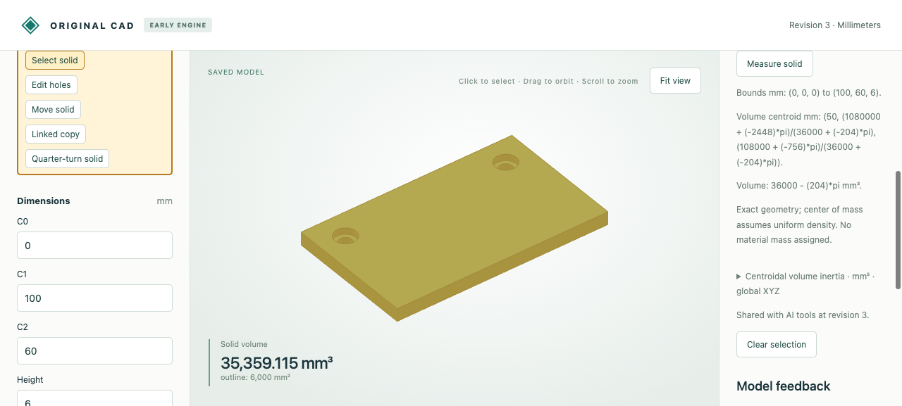

# Exact counterbored through-holes

A counterbore combines a through-hole with a wider flat-bottom recess for a fastener head. The original Rust engine now models the two cylindrical walls and annular shoulder analytically. Named through radii and centers remain editable; the group shares a recess radius and depth. The browser hole editor and typed MCP tools use the same feature contract.

For stock height `h`, through radius `r`, recess radius `R` and depth `d`, removed volume is exactly `pi * (r*r*h + (R*R-r*r)*d)`. Require `R > r > 0` and `0 < d < h`. Recess disks must remain strictly inside the stock and strictly separate. These checks use exact rational predicates. No mesh or OCCT solid cut defines the native result.

## Actual browser and MCP workflow

[Editable browser input](input.cad.json) is a synthetic 100×60×6 mm extruded plate, seeded through the document API. In the browser, Add holes → Counterbored through creates two radius-3 holes centered at `(12,12)` and `(88,12)`, with radius-5 recesses initially 2 mm deep. The [twelve recorded HTTP calls](browser-recording.json) retain creation, a depth edit to 3 mm, measurement, rejected radius-12 recesses and undo. The initial placement preview also rejected zero Y coordinates before the automation committed the Y-field changes; that rejection remains in the recording. Offscreen automation clicks/download attempts produced no model commands; controls were scrolled into view before retrying.

The saved part changes from `36000 − 172π` to `36000 − 204π` mm³. [Eight actual typed MCP calls](mcp-recording.json) independently preview/create the same part from empty, measure, preview/save depth 3, reject an oversized recess, undo and measure again. This verifies transport and schema use; no new natural-language inference run is claimed.

| Stage | Browser download | MCP native snapshot |
|---|---|---|
| Created, depth 2 | [native](browser-created.cad.json) | [native](mcp-created.cad.json) |
| Deeper, depth 3 | [native](browser-deeper.cad.json) | [native](mcp-deeper.cad.json) |
| Undo to depth 2 | [native](browser-undo.cad.json) | [native](mcp-undo.cad.json) |

[Downloaded STL](browser-deeper.stl) is in millimeters with 128 segments per circle. Independent triangle incidence/Euler/volume checks preserve two through-openings and the annular shoulders at z=3 mm. It approximates circular boundaries; the native documents and STEP retain analytic cylinders. Read-only measurements and rejected previews do not write history.



## Independent geometry checks

[Comparison report](independent-comparison.json) covers all eight rows below. An independent OCCT reference subtracts full and partial cylinders from stock. The export adapter instead constructs the supplied native caps, cylinders and shoulders, sews them, and reimports STEP. Checks include valid solids, both directed residual volumes below 1e-6 mm³, area difference below 1e-6 mm², the expected cylinder count, and point classification above/below each shoulder and in each lower aperture. Exact symbolic centroids and every inertia entry agree with independent volume integration within 1e-8 mm and 1e-6 mm⁵.

| Case | Editable feature model | Analytic export |
|---|---|---|
| Plate | [model](plate.model.json) | [STEP](plate.step) |
| Reversed profile winding | [model](reverse_plate.model.json) | [STEP](reverse_plate.step) |
| Unequal through radii | [model](asymmetric.model.json) | [STEP](asymmetric.step) |
| Concave stock | [model](concave.model.json) | [STEP](concave.step) |
| Circular stock | [model](round.model.json) | [STEP](round.step) |
| Fractional recess depth | [model](fractional_depth.model.json) | [STEP](fractional_depth.step) |
| Moved and quarter-turned | [model](turned.model.json) | [STEP](turned.step) |
| Linked circular copy | [model](linked_round.model.json) | [STEP](linked_round.step) |

Tests also cover exact thin shoulders that remain valid natively while float tessellation rejects, tangency/overlap, fixed/derived dimensions, reversible edits, and the full 16-hole/256-segment display limit with 16,392 vertices and closed topology.

## Reproduce

After the [normal setup](../../../tools/ai-cad/README.md):

```sh
python3 -m unittest discover -s tools/ai-cad -p test_counterbores.py -v
node --test tools/ai-cad/test_hole_editor.mjs
python3 tools/ai-cad/verify_counterbores.py
mkdir -p work
cp examples/ai-cad/counterbores/input.cad.json work/counterbored-plate.cad.json
python3 tools/ai-cad/viewer.py --store work/counterbored-plate.cad.json
```

Run `verify_counterbores_mcp.py` with `tools/ai-cad/requirements.lock`, and `verify_counterbores_export.py` with `tools/ai-cad/step-requirements.txt`; optional `--write` regenerates synthetic MCP/reference artifacts. Restart connected MCP clients to load the new feature schema.

Limits: 1–16 non-overlapping, stock-local +Z counterbores in one group on an extrusion or cylinder. One group consumes the original stock; existing whole-part transforms and linked copies apply afterward. No multiple groups, countersinks, threads, arbitrary hole axes or general curved Booleans. The shared recess radius/depth can be parameter-linked; individual recess depths/radii are not exposed. STEP conversion requires radii, shoulder widths, recess depth, remaining lower height and clearances above 1e-6 mm. Export/display failure leaves exact native geometry intact.
