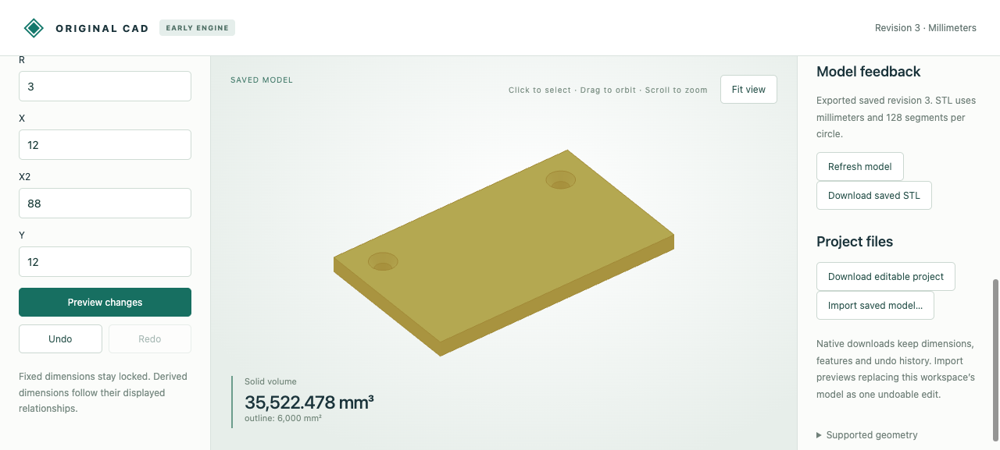

# Exact countersunk through-holes

A countersink joins a cylindrical through aperture to a conical recess at the top of a polygonal or circular stock. The original Rust engine retains exact circle/generator edges, inward conical supports, editable radius/depth and symbolic volume moments. Native geometry does not depend on display triangles or OCCT modeling.

Choose **Add holes → Countersunk through** in the browser. Set the hole centers/through radii and shared recess rim radius/depth, preview and save. Select an inspected conical recess to bind a later dimension edit to that surface context. The angle follows the radii and depth; there is no angle parameter in this feature.



## Retained artifacts

- `input.cad.json`, `browser-created.cad.json`, `browser-deeper.cad.json`, `browser-undo.cad.json`: editable native source/history. The deeper checkpoint is an actual UI download.
- `browser-deeper.stl`: actual128-segment UI download in millimeters. It is a closed triangulated approximation with sloped recess walls and open through apertures.
- `browser-recording.json`: twelve actual browser requests covering creation, exact surface context, guarded depth edit, clearance rejection and undo; disposable display arrays are omitted.
- `mcp-recording.json` and `mcp-*.cad.json`: ten actual typed stdio MCP calls with native checkpoints. This is transport/schema evidence with a synthetic model, not a new language-model inference run.
- Eight `*.model.json`/`*.step` pairs: asymmetrical through radii, reversed winding, concave and round stock, fractional depth, a turned part and a linked copy.
- `independent-comparison.json`: analytic STEP readback versus independent solid subtraction, area, bidirectional residual volume, classification on either side of the sloped wall, exact centroid/inertia and separately reconstructed shared-boundary comparisons.

The removed volume of one hole is `pi*(r²*(h-d)+d*(r²+rR+R²)/3)`. The integrated conical moments are exact rational coefficients of pi. Tests also cover every coordinate quarter turn,16 holes at256 segments, native sub-display-precision tapers, damaged inward orientation and atomic native undo/reopen.

## Reproduce

Follow the [workflow setup](../../../tools/ai-cad/README.md), then run from the repository root:

```sh
python -m unittest discover -s tools/ai-cad -p test_countersinks.py -v
python tools/ai-cad/verify_countersinks.py
# MCP environment:
python tools/ai-cad/verify_countersinks_mcp.py
# Optional comparison environment:
python tools/ai-cad/verify_countersinks_export.py
```

The shared rim radius must exceed each through radius. Depth must be positive and strictly below stock height. Top disks must remain strictly inside stock and separate. One group per extrusion/cylinder, with shared rim radius/depth; placed source stock and tapered stock are not hole inputs. Existing movement/turns/linked copies can follow the result. Mixed-depth groups, arbitrary hole axes, specified-angle authoring, threads and general curved Booleans remain open. STEP uses1e-6mm adapter thresholds, independently of exact native validity.
