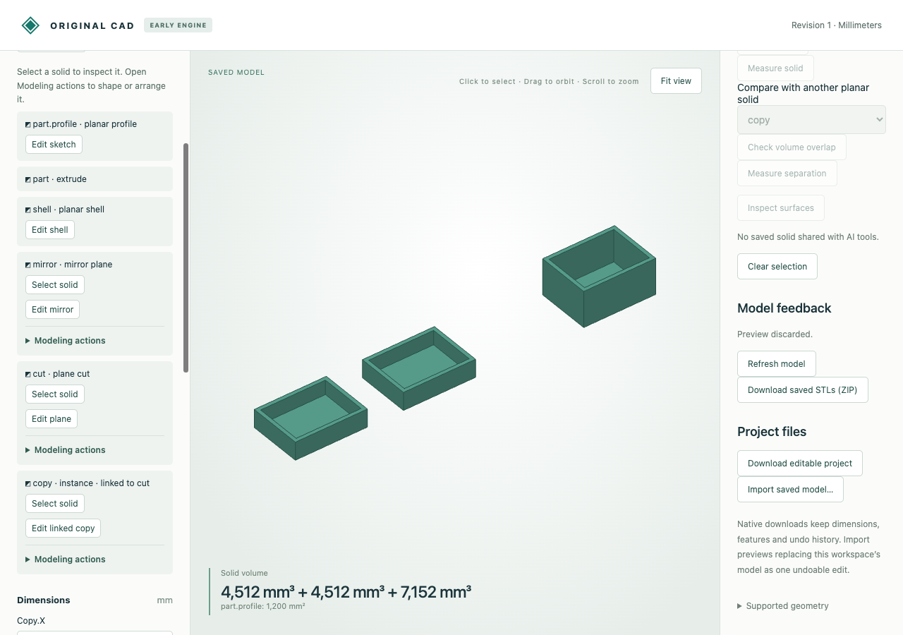

# Compact feature actions

Selection and edits to an existing feature stay visible in the feature tree. New
operations live under **Modeling actions** for each eligible solid. Open one menu
at a time; Enter/Space work on its summary. The chosen menu survives model redraws,
and preview controls keep the same disabled state as before.



The same six-feature, three-part document was inspected in the old and new viewer.
At the measured layout, feature-tree height fell from **1230 to 656 px**, and visible
buttons from **28 to 8**. This is a local UI observation, not a general performance
benchmark. Opening menus caused zero GPU buffer uploads; an explicit full refresh
caused one upload. Geometry, document history and AI command behavior are unchanged.

| Artifact | Purpose |
|---|---|
| [Editable source](source.cad.json) | Enclosure, linked mirror, plane cut and linked instance used in both viewers |
| [Before](before.png), [after](after.png) | Actual desktop captures at 1280 × 900 |
| [Browser audit](browser-audit.json) | Measured layout, one-open-menu behavior, keyboard toggles, redraw and preview/discard control states |
| [Browser recording](browser-recording.json) | Three actual preview-job requests initiated through the disclosed Move action |
| [Runtime report](browser-runtime.json) | Worker activity and matching native-file hashes before/after the browser session |

Import the source into the viewer, open **Modeling actions** under `copy`, and choose
**Move solid**. Preview then discard. **Edit linked copy** remains visible outside
the menu; the separate **Linked copy** action creates another copy. Open the menu
under `cut` to find **Add next plane cut**, while **Edit plane** stays visible.

From the repository root after building the native engine:

```sh
python3 tools/ai-cad/verify_feature_actions.py
```

This replays the recorded preview and checks retained audit consistency. It does not
rerun a browser or claim to remeasure layout/GPU behavior in CI. The browser session
also verified menu persistence after explicit refresh, disabled feature actions during
preview, restored controls/open menu after discard, and unchanged saved document bytes.
