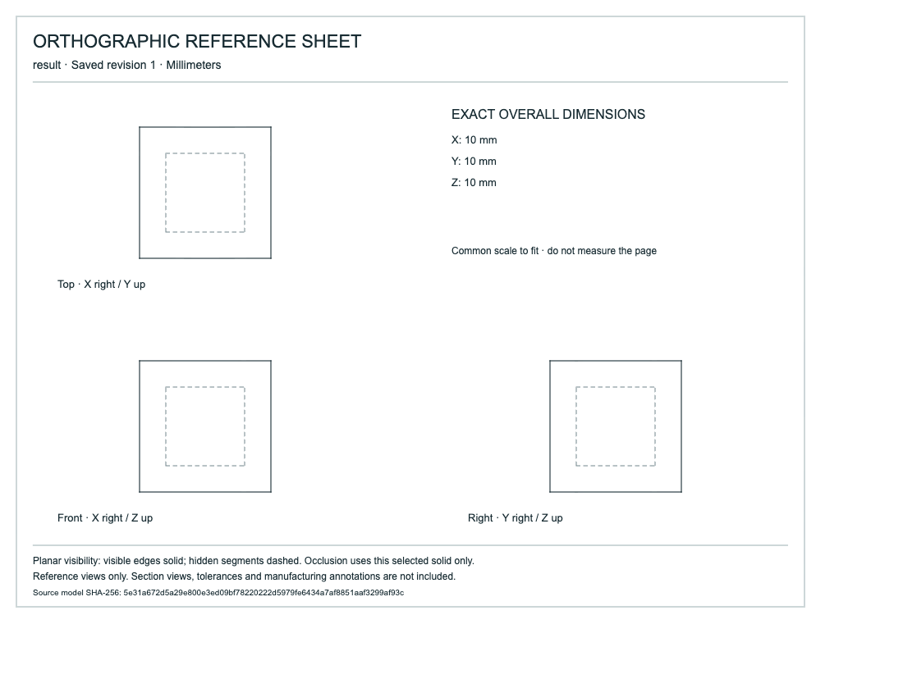

# Planar hidden-line reference sheets

A 10 mm cube contains a closed 6 mm cavity. The optional planar style shows its hidden edges dashed in top/front/right views. Editing cavity height to4 mm changes the hidden front/right linework; undo restores the original geometry at a new revision. A separate cylindrical body verifies explicit curved-style rejection and does not occlude the selected cube.



## Artifacts

- [source.cad.json](source.cad.json), [edited.cad.json](edited.cad.json), [undo.cad.json](undo.cad.json): editable native history at revisions1,2,3.
- [source.svg](source.svg), [edited.svg](edited.svg), [undo.svg](undo.svg): finished vector sheets with native model hash and exact edge interval metadata. Open in a browser or SVG editor.
- [all-edges.svg](all-edges.svg): default style for comparison.
- [mcp-recording.json](mcp-recording.json): eight actual typed calls, including curved rejection, source edit and undo.
- [browser-download.svg](browser-download.svg), [browser-all-edges.svg](browser-all-edges.svg): actual browser downloads, byte-identical to their MCP outputs.
- [browser-export.json](browser-export.json), [browser-runtime.json](browser-runtime.json): two captured HTTP replies and unchanged native-file SHA-256 evidence.
- [browser-sheet.png](browser-sheet.png): visually inspected rendered hidden-line sheet.

## Reproduce

From a clean checkout, build the Rust model engine and install `tools/ai-cad/requirements.lock` as described in the [host setup](../../../tools/ai-cad/README.md).

```sh
python tools/ai-cad/verify_hidden_sheets.py
python tools/ai-cad/verify_hidden_sheets_mcp.py
python tools/ai-cad/drawings.py --store examples/ai-cad/hidden-line-sheets/source.cad.json --revision 1 --body result --style planar_hidden --output hidden.svg
python -m unittest discover -s tools/ai-cad -p 'test_planar_visibility.py'
```

Add `--write` to the MCP verifier to regenerate native/SVG/MCP artifacts. Browser recordings remain separately captured evidence; the script does not fabricate them.

## Scope and validation

Exact rational face-boundary/depth crossings split native lines before display conversion. Closed face loops preserve holes; all components of the selected solid participate. Visible coverage wins when projected segments coincide, eliminating hidden dashes on a visible outline. Output retains one representative native edge and rational interval per rendered segment. Tests independently check near/far box rims in all views, a partially occluded edge split at5+10⁻³⁰ mm, visibility through a hole, enclosed cavities, translations, projected merging and budget failures.

Only planar solids are supported by this style. Separate terminal solids do not occlude one another. Bounds:256 edges,128 faces,2048-bit input coefficients,500000 counted work steps and5 seconds shared across the three views and merge. Existing SVG display precision, label and4 MiB limits also apply. No section view, tolerance, persistent drawing association or manufacturing approval is implied. Use dimension labels rather than measuring the fitted page.
