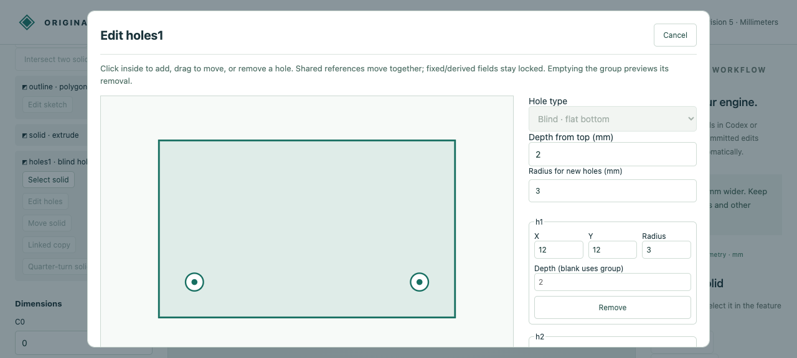

# Individual blind-hole depths

A named blind-hole group now supports distinct depths while retaining a shared default. The original Rust engine computes each floor, cylindrical wall, exact volume and symbolic moments; display triangles remain disposable.

Choose **Add holes → Blind · flat bottom**. A blank per-hole depth uses the group value. Enter an integer or fraction to create an individual depth; **Use group depth** reconnects the default. Fixed/derived individual values stay locked, and reconnecting retains their old parameters. Every depth must be positive and strictly below stock height.



## Retained artifacts

- `input.cad.json`, `browser-created.cad.json`, `browser-deeper.cad.json`, `browser-reset.cad.json`, `browser-undo.cad.json`: editable native source/history. Two holes start at2/4mm; the second grows to5mm, returns to the2mm default, then undo restores5mm. The deeper checkpoint is an actual browser download.
- `browser-deeper.stl`: actual128-segment browser download. Independent mesh auditing checks closure, volume and separate floors at1 and4mm above the base.
- `browser-recording.json`: twelve actual HTTP calls; creation, resize, through-stock rejection, default reconnection and undo. Display arrays are omitted, and the recording is replayed against native state.
- `mcp-recording.json`, `mcp-*.cad.json`: ten actual typed stdio MCP calls with creation, exact measurement/topology, floor selection, guarded resize, rejection and undo. Synthetic transport evidence; no new model-inference claim.
- Eight `*.model.json`/`*.step` pairs: unequal radii, concave and round stock, reversed winding, fractional depths, a quarter-turned part and a linked copy.
- `independent-comparison.json`: STEP readback versus independently subtracted cylinders; solid validity, area, bidirectional residuals, material below/void above each floor, centroid/inertia and separate shared-boundary reconstruction.

The removed volume is `pi*sum(radius_i²*depth_i)`. Tests cover all coordinate quarter turns,16 distinct depths at256 display segments, exact sub-display floors, dependency/fixed rules, unchanged old uniform-depth replies and native atomic rollback/reopen/undo/redo.

## Reproduce

Follow the [workflow setup](../../../tools/ai-cad/README.md), then run from the repository root:

```sh
python -m unittest discover -s tools/ai-cad -p test_individual_depths.py -v
python tools/ai-cad/verify_individual_depths.py
# MCP environment:
python tools/ai-cad/verify_individual_depths_mcp.py
# Optional comparison environment:
python tools/ai-cad/verify_individual_depths_export.py
```

Optional `depth_overrides` maps existing hole IDs to parameter IDs. The default remains required and valid. Through, counterbore and countersink groups do not accept this map. Holes remain strictly separated/contained, limited to16 and one group per unplaced extrusion/cylinder. Intersecting pockets, arbitrary axes, drilling tips, threading and general curved Booleans remain open. STEP requires every depth and remaining floor above1e-6mm independently of exact native validity.
