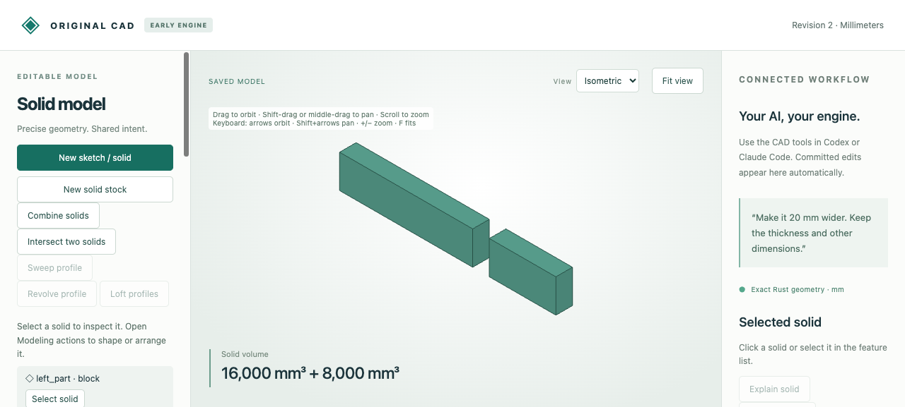

# Coupled dimensions that remain editable

Two part widths must fill an overall span around a fixed gap, while the left part
is twice as wide as the right. Solve these together:

```text
left + right + gap = span
left - 2 × right = 0
```

The original exact linear solver targets `left` and `right`, producing persistent
formulas `left = 2/3 × (span-gap)` and `right = 1/3 × (span-gap)`. Another ordinary
relationship places the second part at `offset = left + gap`.



With span100 and gap10 mm, widths are60 and30 mm. Change span to130: widths become
80 and40, and the second part moves from X=70 to90, retaining the10 mm gap. Both
parts have depth10 and height20 mm, so volumes change from12000/6000 to16000/8000
mm³. A span of5 mm would produce negative widths and rejects without saving.
Undo restores the initial dimensions and formulas.

After the [quickstart](../../../tools/ai-cad/README.md):

```sh
python3 tools/ai-cad/cad.py --store work/coupled.cad.json < examples/ai-cad/linear-constraints/create.json
python3 tools/ai-cad/viewer.py --store work/coupled.cad.json
```

Edit **Span** in the browser; Left, Right and Offset are derived/read-only. Equation
authoring uses CLI/MCP. `create.json` retains the original rows; the saved model
stores their equivalent affine formulas, without row labels or redundant rows.
Use `constrain_linear` again to replace target formulas, or explicitly remove a
relationship to release its effect. Other existing relationships remain intact.

| Artifact | Purpose |
|---|---|
| [Create command](create.json), [MCP arguments](create.request.json) | Original equations, inputs, parts and placement relationship |
| [MCP recording](mcp-recording.json), [created](mcp-created.cad.json), [edited](mcp-edited.cad.json), [undo](mcp-undo.cad.json) | Ten actual typed calls, exact formulas, driver edits, diagnostics and native history |
| [Browser source](browser-source.cad.json), [edited](browser-edited.cad.json), [undo](browser-undo.cad.json) | Browser editing of the same compiled constraints |
| [Browser recording](browser-recording.json), [audit](browser-audit.json), [runtime](browser-runtime.json) | Six actual API/job calls, derived controls and unchanged saved bytes on invalid edit |
| [Native download](browser-download.cad.json), [two-part STL ZIP](browser-edited.zip) | Actual downloaded editable history and placed solid meshes with manifest |

```sh
python3 -m unittest discover -s tools/ai-cad -p test_linear_constraints.py -v
python3 tools/ai-cad/verify_linear_constraints.py
python3 tools/ai-cad/verify_linear_constraints_mcp.py
```

The MCP check needs the optional locked MCP environment and accepts `--write`.
The replay verifies recorded responses, exact native histories, derived controls,
STL volumes/manifold orientation and X bounds0..80 /90..130. Forty seeded symbolic
systems satisfy every original equation before and after rational driver edits;
fixed/preserve, cycles, consistent redundancy, rank deficiency, contradictions,
free-driver restrictions, arithmetic limits and atomic failure are covered.

The bounded solver uses exact rational elimination:1..16 targets,1..32 equations,
at most8 nonzero terms per row and128-bit input/intermediate/result components.
Each resulting formula must fit8 driver terms. Driver-only residual constraints
reject even if today's values satisfy them; the solver does not silently fix
free dimensions. Error provenance names involved rows, not a minimal conflict set.
No nonlinear distance, angle, tangency or inequality solving is provided. See the
[contract](../../../docs/ai-cad-contract.md#simultaneous-exact-linear-constraints).
