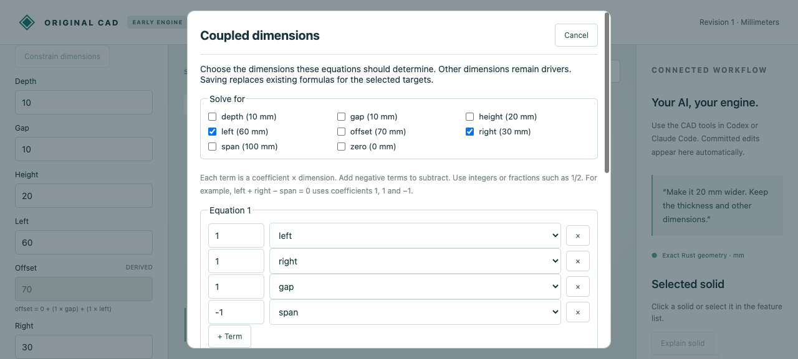
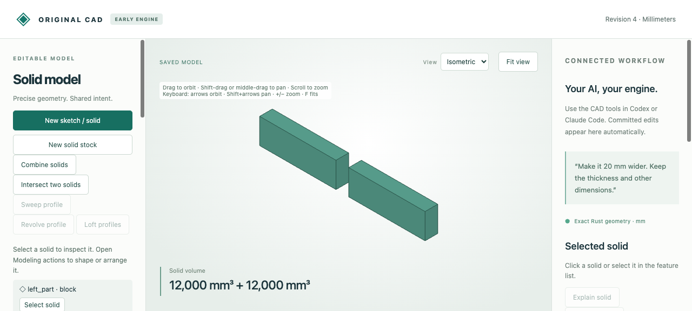

# Author coupled dimensions in the browser

Choose **Constrain dimensions** below the feature tree. Select the dimensions to
solve for, then add terms with named dimensions and exact integer/fraction
coefficients. Each row's sum equals its right-side millimeter value. Preview
checks the equations and resulting geometry; save makes one undoable edit.



Open [the source project](browser-source.cad.json) through **Import saved model**.
It contains two independent widths, a span, a gap and a placement formula.
Select Left and Right as targets, then enter:

| Equation | Terms (dimension × coefficient) | Right side mm |
|---|---|---:|
| Span | left ×1, right ×1, gap ×1, span ×−1 | 0 |
| Ratio | left ×1, right ×−2 | 0 |

Previewing only the first row reports insufficient rank and retains the selected
targets and all four terms. Add the second equation, preview and save. Widths 60/30
become derived. Edit Span 100→130 in the ordinary dimensions panel: widths become
80/40 and Offset becomes 90, retaining the 10 mm gap.

Reopen the constraint editor and replace the ratio row with `left ×1 + right ×−1
= 0`, retaining the span equation and the same targets. Saving produces equal
widths 60/60 and Offset 70. Undo restores the previous 2:1 rules and widths 80/40.



| Artifact | Purpose |
|---|---|
| [Source](browser-source.cad.json), [created](browser-created.cad.json) | Independent dimensions and first browser-authored constraints |
| [Driver edit](browser-edited.cad.json), [replacement](browser-replaced.cad.json), [undo](browser-undo.cad.json) | Editable source change, new formulas and restored ratio |
| [Native download](browser-download.cad.json), [STL ZIP](browser-edited.zip) | Actual downloads of the 80/40 model; native history and placed solid meshes |
| [Recording](browser-recording.json), [audit](browser-audit.json), [runtime](browser-runtime.json) | Twelve actual API/job calls, retained invalid draft and derived controls |

After the [quickstart](../../../tools/ai-cad/README.md):

```sh
node --test tools/ai-cad/test_linear_editor.mjs
python3 tools/ai-cad/verify_linear_editor.py
```

The replay validates exact responses and native histories, error repair, formula
replacement and undo. It checks both STL parts for closed outward topology,
volumes 16000/8000 mm³ and X bounds 0..80 /90..130. The native engine remains
responsible for rank, contradiction, fixed/preserve, cycle and geometry checks.
The UI does not select missing degrees of freedom or replace constraints before
saving. Cancel closes the draft without changing the document.

Select 1..16 targets and enter 1..32 equations, each with 1..8 nonzero terms. Combine
repeated terms for one parameter yourself. Coefficients and right-side values use
integers/fractions; no equation-text parser or nonlinear angle/distance constraints
are provided. Saved formulas preserve the equations' effect; original row labels
and redundant rows are not retained. Only selected target formulas are replaced.
See the [exact solver contract](../../../docs/ai-cad-contract.md#simultaneous-exact-linear-constraints).
