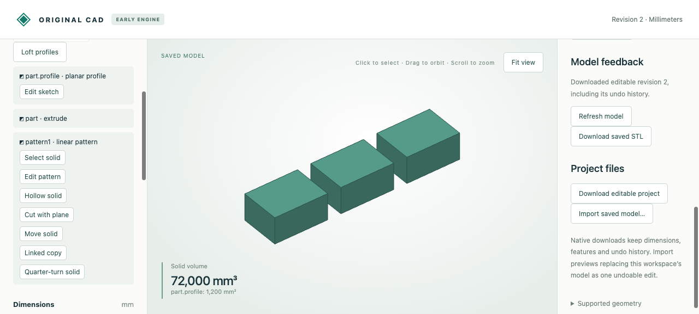

# Linked linear material patterns

Repeat planar material at exact global XYZ offsets. One native `linear_pattern`
feature unions the original and its translated copies. Source edits propagate to
all copies; count and parameter-backed spacing remain editable.



Open [browser-stock.cad.json](browser-stock.cad.json) using **Import saved model**.
Choose **Linear pattern**, keep count 3 and X step 50 mm, then preview/save. The
40 × 30 × 20 mm source becomes three components totaling **72000 mm³**. Set count
4 and X step 40 to join the copies (**96000 mm³**). Widen the source to 50 mm:
overlapping material is counted once, producing **102000 mm³**. Zero spacing
rejects without saving; undo restores the previous source width.

| Artifact | Purpose |
|---|---|
| [Starting stock](browser-stock.cad.json) | Editable source at revision 1 |
| [Pattern](browser-created.cad.json) | Downloaded native three-copy pattern |
| [Joined pattern](browser-joined.cad.json), [STL](browser-joined.stl) | Downloaded four-copy joined result and closed oriented mesh |
| [Widened source](browser-upstream.cad.json) | Source edit propagated through overlapping copies |
| [Undo](browser-undo.cad.json) | Saved history after undoing the source edit |
| [Browser recording](browser-recording.json) | Twelve actual editing/job requests, including rejected zero step |
| [MCP recording](mcp-recording.json) | Ten actual typed stdio calls: create, inspect surfaces/measure, edit, reject, undo |
| [MCP created](mcp-created.cad.json), [edited](mcp-deeper.cad.json), [undo](mcp-undo.cad.json) | Native MCP checkpoints |
| [Independent comparison](independent-comparison.json) | Eight source-built repeated unions, STEP/shared topology residuals and moments |
| `*.model.json`, matching `*.step` | Editable source objects and exported STEP solids for all eight cases |
| [Joined view](joined.png) | Actual viewport after widening the source |

The eight reference cases are `separate`, `face_join`, `overlap`, `negative`,
`diagonal_fractional`, `concave`, `tapered`, and `turned`. STEP can contain multiple
solids for separated components. Open it in any STEP-capable CAD application.
Native `*.cad.json` retains history; `*.model.json` is the engine model object.

Run from the repository root after the [quickstart](../../../tools/ai-cad/README.md):

```sh
python3 -m unittest discover -s tools/ai-cad -p test_linear_pattern.py -v
node --test tools/ai-cad/test_pattern_editor.mjs
python3 tools/ai-cad/verify_linear_pattern.py
python3 tools/ai-cad/verify_linear_pattern_mcp.py
python3 tools/ai-cad/verify_linear_pattern_export.py
```

MCP verification needs `tools/ai-cad/requirements.lock`; independent STEP checks need
`tools/ai-cad/step-requirements.txt`. The last two scripts accept `--write` to refresh
retained outputs. Browser replay checks actual recorded calls and downloaded files;
it does not fabricate a new browser run.

This is material repetition in one feature/body. Overlaps merge, face joins connect,
and separated pieces remain components; use linked instances for independent parts.
Only planar material is supported, including concavity and cavities. Count is an
integer 1..16 including the source. Nonzero spacing is required above count 1;
step and total displacement are each bounded to ±1000000 mm per axis. Existing
32-cell/256-cell-face and boundary limits can reject complex patterns below 16
copies. Nonmanifold edge/point contact rejects. Curved/circular patterns and
independent assembly pattern identities remain future work.
