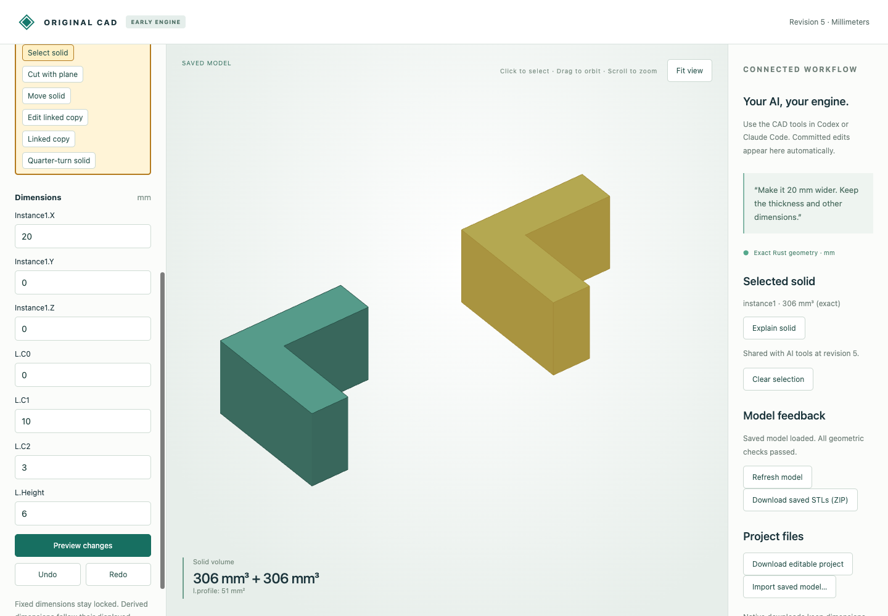

# Linked planar part instances

**Linked copy** creates a translated placement of an earlier solid while keeping its source available. Editing source dimensions updates all linked copies; each copy has independent parameter-backed XYZ offsets. Copies can refer to other copies and can feed plane cuts, turns and Boolean features. The source is an explicit feature reference, including an earlier historical feature if selected through the typed API.

This introduces part reuse within one document. It does not introduce assembly joints, collision checking, external part documents or GPU instancing. Native geometry and display meshes are currently regenerated for each placement. Overlapping bodies remain separate; their individual volumes are not a union total.

## Actual browser and MCP evidence

The browser begins with a synthetic [L-shaped source](mcp-input.cad.json), creates a linked copy at x=20, changes source height from 4 to 6, moves only the copy to x=30, rejects height -1, and undoes the placement edit. [Twelve captured HTTP calls](browser-recording.json) retain preview jobs, commits, rejection and undo. The selected copy in the screenshot was selected after reloading the final saved revision.

| Editable native stage | Revision | Source/copy volumes mm³ | Copy x offset |
|---|---:|---|---:|
| [Pair](browser-pair.cad.json) | 2 | 204 / 204 | 20 |
| [Shared height edit](browser-edited.cad.json) | 3 | 306 / 306 | 20 |
| [Independent placement](browser-moved.cad.json) | 4 | 306 / 306 | 30 |
| [Undo](browser-undo.cad.json) | 5 | 306 / 306 | 20 |

[Downloaded parts ZIP](browser-parts.zip) contains two closed oriented STLs and a revision manifest. Each volume is 306 mm³; world bounds are `(0,0,0)`–`(10,10,6)` and `(30,0,0)`–`(40,10,6)`. Native files retain dimensions, source links and undo; STL/STEP retain placed geometry only.



[Seven actual MCP calls](mcp-recording.json) create the [source](mcp-input.cad.json), [linked pair](mcp-pair.cad.json), [edit shared height](mcp-edited.cad.json), and reject deletion of a referenced source without changing saved bytes. These are typed transport executions without a new inference session.

## Independent STEP comparison

The oracle independently builds the source and places it with OCCT. STEP translation uses the Rust result boundary. [Measurements](step-comparison.json) check valid solids, component count, volume, area and bidirectional residual volumes below 1e-7 mm³.

| Case | Typed source | Finished STEP |
|---|---|---|
| Concave copy | [model](concave_copy.model.json) | [STEP](concave_copy.step) |
| Nested placement | [model](nested_copy.model.json) | [STEP](nested_copy.step) |
| Closed cavity | [model](cavity_copy.model.json) | [STEP](cavity_copy.step) |
| Separate pieces | [model](split_copy.model.json) | [STEP](split_copy.step) |
| Turned copy | [model](turned_copy.model.json) | [STEP](turned_copy.step) |

## Reproduce

After the [portable setup](../../../tools/ai-cad/README.md), run from the repository root:

```sh
python3 -m unittest discover -s tools/ai-cad -p test_instances.py -v
node --test tools/ai-cad/test_translation_editor.mjs
python3 tools/ai-cad/verify_instances.py
mkdir -p work
cp examples/ai-cad/linked-instances/browser-undo.cad.json work/parts.cad.json
python3 tools/ai-cad/viewer.py --store work/parts.cad.json
```

Run `verify_instances_mcp.py` with `tools/ai-cad/requirements.lock` and `verify_instances_export.py` with `tools/ai-cad/step-requirements.txt`. Optional `--write` regenerates their synthetic artifacts. Tests cover nested propagation, provenance/impact, independent offsets, later consuming operations, forward/self-reference rejection, invalid source removal, fixed offsets and undo/reopen.

Only supported unperforated planar stock and original planar operation results can be instanced. Circular analytic stock and analytic hole groups reject. Offset components are bounded to ±1000000 mm; existing model/cell limits apply. Orientation uses a subsequent quarter-turn feature. A source feature denotes that historical modeling stage, not an automatically followed later tip. Generated face indices are not persistent references.

Subsequent support: [analytic rigid placement](../analytic-placement/README.md) now admits circular stock and through/blind-hole groups. Earlier curved-placement exclusions describe the original checkpoint.
