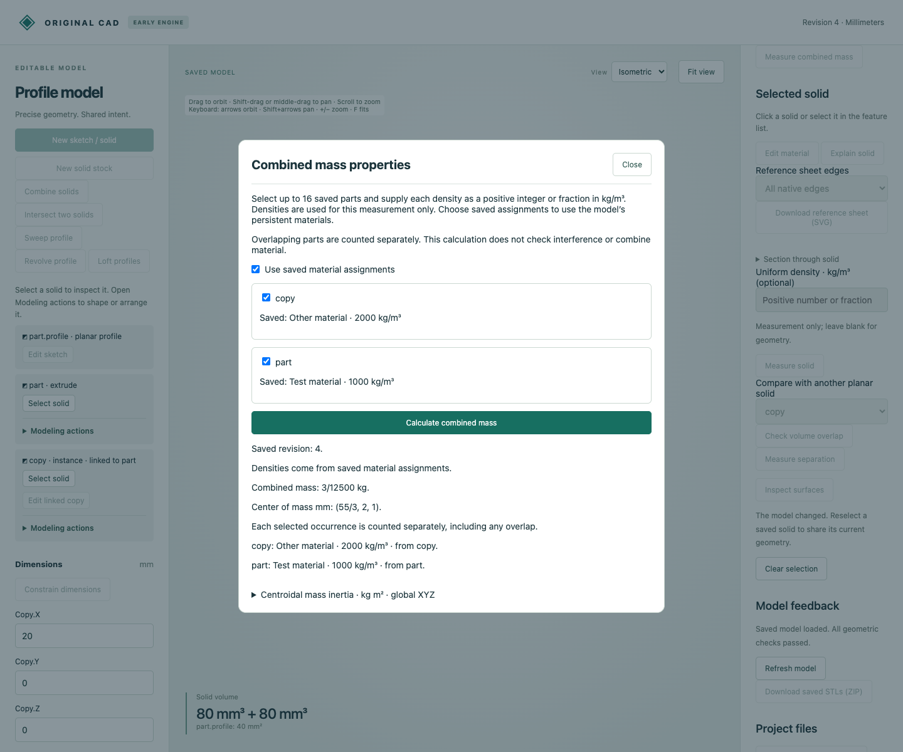

# Saved materials and assigned mass

Uniform material assignments now live in the native document and participate in preview, save, reopen and undo. A source part's linked copies inherit its material until explicitly overridden. Combined mass can use those saved assignments instead of temporary density inputs.



The examples use synthetic material names and densities for exact verification, not a validated alloy or manufacturing material library. Both parts have volume80 mm³. At densities1000 and2000 kg/m³, their combined mass is3/12500 kg and X center of mass55/3 mm.

## Artifacts

| Files | Purpose |
|---|---|
| [source.cad.json](source.cad.json) | Source has density1000; linked copy inherits. Total mass1/6250 kg. |
| [override.cad.json](override.cad.json) | Copy gets its own2000 density. Total3/12500 kg. |
| [edited.cad.json](edited.cad.json) | Source becomes3000; copy remains2000. Total1/2500 kg. |
| [inherited.cad.json](inherited.cad.json) | Copy override is cleared; both inherit3000. Total3/6250 kg. |
| [undo.cad.json](undo.cad.json) | Undo restores the copy override at a new revision. |
| [mcp-recording.json](mcp-recording.json) | Eleven actual typed calls, exact mass and unchanged geometry. |
| [browser-source.cad.json](browser-source.cad.json), [browser-override.cad.json](browser-override.cad.json), [browser-inherited.cad.json](browser-inherited.cad.json), [browser-undo.cad.json](browser-undo.cad.json) | Browser preview/save, clear override and undo stages. |
| [browser-download.cad.json](browser-download.cad.json) | Actual editable native download matching the browser's final state. |
| [browser-recording.json](browser-recording.json), [browser-runtime.json](browser-runtime.json), [browser-audit.json](browser-audit.json) | Nine actual calls, exact file hashes and rendered mass result. |
| [browser-mass.png](browser-mass.png) | Visually inspected saved-material names, densities and combined mass. |

## Reproduce

Use the [host setup](../../../tools/ai-cad/README.md) to build the current Rust engine and install the MCP requirements. Then, from the repository root:

```sh
python -m unittest discover -s tools/ai-cad -p 'test_materials.py'
node --test tools/ai-cad/test_material_editor.mjs
python tools/ai-cad/verify_materials.py
python tools/ai-cad/verify_materials_mcp.py
python tools/ai-cad/viewer.py --store examples/ai-cad/materials/override.cad.json
```

Use a copy of the example document for interactive edits. In the viewer select a solid, **Edit material**, enter a name and positive integer/fraction density, preview and save. The target selector also exposes retained source features. **Preview clearing override** restores ancestry rather than clearing a source assignment implicitly. **Measure combined mass → Use saved material assignments** uses the saved values and lists their sources. Existing temporary density mode remains available.

Add `--write` to the MCP verifier to regenerate its native stages and recording. Browser evidence is recorded separately. Exact host/native validation includes planar and curved Boolean inheritance, mixed/missing input conflicts, explicit overrides, removal checks, invalid values, history, cache invalidation and independent SI mass formulas.

## Inheritance and limits

- Unary solid edits, transforms, patterns and linked copies inherit their input state.
- Boolean difference inherits only the left target's material; the cutting tool does not change it.
- Union/intersection require identical assigned names and normalized densities on every input. All unassigned inputs yield unassigned; a mixture or prior conflict yields conflict. Mass from saved assignments rejects unresolved parts.
- A direct override assigns one uniform material to the entire resulting solid. It does not retain distinct densities in Boolean regions. Clearing restores ancestry; remove a feature's override explicitly in the same transaction when deleting it.
- Assignments reference solid feature IDs, including retained sources. Sketch assignments reject. Names are1..80 non-control Unicode characters without outer whitespace; densities are positive exact rational kg/m³ with the native128-bit limit. At most32 overrides fit the existing32-feature model bound.
- Geometry and explicit-density measurement APIs remain unchanged. Native files retain assignments/history; STEP/STL geometry exports currently omit this material metadata. Earlier engines reject documents containing the new optional `materials` field; models without materials retain their previous output.

This is a uniform-density engineering foundation. It does not supply certified material data, anisotropy, temperature dependence, heterogeneous-region mass, appearance shaders, part numbering or a shared material catalog.
