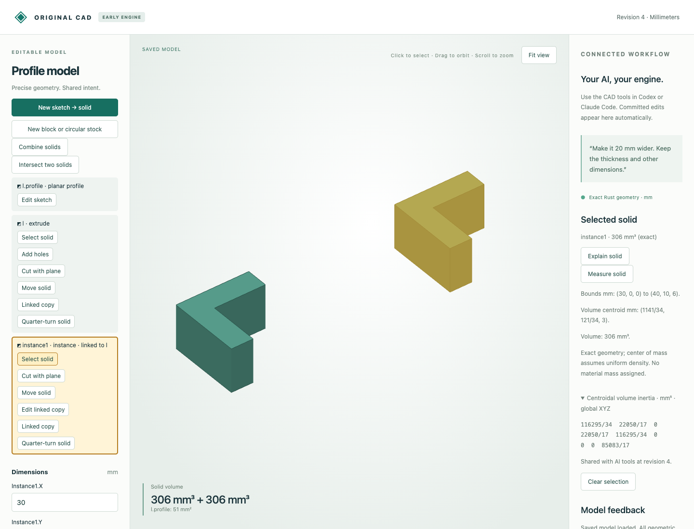

# Exact planar engineering measurements

**Measure solid** and typed `cad_measure` return exact rational world-axis bounds, volume centroid and the centroidal volume inertia tensor of a selected terminal planar solid. The tensor integrates `(r² I − r rᵀ) dV` about the volume centroid, expressed in global XYZ axes. Its units are mm⁵. Multiplying by a uniform density gives mass inertia; no density or physical mass is assigned here.

The original Rust engine integrates oriented boundary loops as signed tetrahedral chains. Concave loops, hole loops, cavities and disconnected pieces retain their signs. These integration triangles do not become modeling or display geometry. Exact integrated volume must equal the independently validated body volume. Arithmetic is bounded to 8192-bit rational moment values; model/process limits also apply. Analytic circular stock and circular hole groups explicitly reject.

## Actual browser and MCP

[Editable native input](input.cad.json) contains a 6 mm thick L-part and a linked copy translated by `(30,0,0)`. [Two actual browser requests](browser-recording.json) measure the copy and source. Selecting the source clears the previous measurement before a new request. Native bytes are unchanged. [Four actual MCP calls](mcp-recording.json) measure both parts and reject stale revision and missing body requests, also without saving. No new inference run is claimed.

| Body | Volume mm³ | Centroid mm | Bounds mm |
|---|---:|---|---|
| Source `l` | 306 | `(121/34, 121/34, 3)` | `(0,0,0)`–`(10,10,6)` |
| Copy `instance1` | 306 | `(1141/34, 121/34, 3)` | `(30,0,0)`–`(40,10,6)` |



## Independent references and closed forms

[Comparison results](independent-comparison.json) retain exact results and independently constructed OCCT references for all ten cases. Each component is integrated separately, then combined by the parallel-axis theorem. Tolerances: volume 1e-7 mm³, centroid 1e-8 mm, each tensor entry 1e-6 mm⁵.

| Typed editable source | Case |
|---|---|
| [overlap.model.json](overlap.model.json) | Overlapping-cube union |
| [cavity.model.json](cavity.model.json) | Closed internal cavity |
| [through.model.json](through.model.json) | Through-hole |
| [split.model.json](split.model.json) | Split stock |
| [separate.model.json](separate.model.json) | Separate cubes |
| [l_shape.model.json](l_shape.model.json) | Boolean L-solid |
| [concave.model.json](concave.model.json) | Initial concave prism |
| [oblique.model.json](oblique.model.json) | Oblique profile cut |
| [placed.model.json](placed.model.json) | Fractional linked placement |
| [turned.model.json](turned.model.json) | Moved and quarter-turned part |

The installed reference library's direct whole-compound integration returned centroid `(15.3125,5.3125,5)` for equal cubes centered at `(5,5,5)` and `(25,5,5)`. Separate-solid integration plus parallel-axis aggregation returns the correct `(15,5,5)` and tensor. The report retains the whole-compound centroid as diagnostic evidence; it is not used as the acceptance oracle. This observation does not identify an upstream root cause. Closed-form tests independently check the separated cubes' full tensor, a rectangular box and a shifted tetrahedron, plus cavity subtraction and rigid-transform covariance.

## Reproduce

After [build/setup](../../../tools/ai-cad/README.md), run:

```sh
python3 -m unittest discover -s tools/ai-cad -p test_measurements.py -v
python3 tools/ai-cad/verify_measurements.py
mkdir -p work
cp examples/ai-cad/measurements/input.cad.json work/measured.cad.json
python3 tools/ai-cad/viewer.py --store work/measured.cad.json
```

Select either part and choose **Measure solid**. Run `verify_measurements_mcp.py` with `tools/ai-cad/requirements.lock`, and `verify_measurements_reference.py` with `tools/ai-cad/step-requirements.txt`; optional `--write` regenerates their synthetic artifacts. Measurement is read-only and revision-bound. It does not measure clearance, infer collisions, sum overlapping bodies, compute surface area or assign materials. A disconnected selected body is integrated as a whole. Centroid need not lie inside material.
