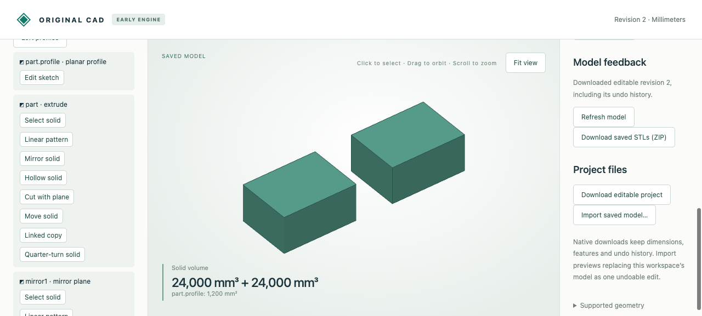

# Exact planar mirrors

Reflect planar material across an exact rational plane. Source dimensions remain
editable; **Keep source** creates a linked counterpart, while clearing it replaces
the terminal source body with its reflection. Oblique planes retain rational native
coordinates and outward boundary orientation.



Import [browser-stock.cad.json](browser-stock.cad.json), choose **Mirror solid**, use
normal `(1,0,0)` and offset `50`, and preview/save with **Keep source** checked.
The original and reflected 40 × 30 × 20 mm parts each retain **24000 mm³**. Edit the
mirror to normal `(1,2,3)`, offset `7/3`, and clear **Keep source**. The resulting
oblique reflection still has exact volume **24000 mm³**. A zero normal rejects;
undo restores the earlier linked pair.

| Artifact | Purpose |
|---|---|
| [Starting stock](browser-stock.cad.json) | Editable source, revision 1 |
| [Linked pair](browser-created.cad.json) | Actual native download after creation |
| [Oblique reflection](browser-oblique.cad.json), [STL](browser-oblique.stl) | Native edit and closed, outward-oriented exported mesh |
| [Undo](browser-undo.cad.json) | Restored linked pair with native history |
| [Browser recording](browser-recording.json) | Eleven actual edit/job requests, including rejected zero-normal creation and edit |
| [MCP recording](mcp-recording.json) | Ten actual typed stdio calls: create, measure/select surface, edit, reject, undo |
| [MCP created](mcp-created.cad.json), [edit](mcp-deeper.cad.json), [undo](mcp-undo.cad.json) | Native transport checkpoints |
| [Independent comparison](independent-comparison.json) | Nine independently reflected reference solids, STEP/shared topology residuals and moments |
| `*.model.json`, matching `*.step` | Editable source objects and actual STEP exports for all nine references |
| [Oblique viewport](oblique.png) | Saved reflected solid after editing |

Reference names: `x_plane`, `y_plane`, `z_plane`, `oblique`, `scaled_plane`,
`concave`, `tapered`, `disconnected`, `turned`. Open STEP in a STEP-capable CAD
application. `*.model.json` is the engine model; native `*.cad.json` also retains
history and receipts. The independent reflection uses source-built OCCT solids
only in verification; native modeling has no OCCT fallback.

Run from the repository root after the [quickstart](../../../tools/ai-cad/README.md):

```sh
python3 -m unittest discover -s tools/ai-cad -p test_mirror.py -v
node --test tools/ai-cad/test_mirror_editor.mjs
python3 tools/ai-cad/verify_mirror.py
python3 tools/ai-cad/verify_mirror_mcp.py
python3 tools/ai-cad/verify_mirror_export.py
```

MCP needs `tools/ai-cad/requirements.lock`; independent STEP comparisons need
`tools/ai-cad/step-requirements.txt`. The last two verifiers accept `--write` to
refresh their artifacts. Browser replay verifies the retained actual responses.

Limits: planar material, including concavity, cavities and disconnected pieces;
no reflection of analytic curved/perforated stock yet. Normal components are rational
literals and must be nonzero as a vector. Offset is a parameter reference, with
`normal dot position = offset`; scale both sides to retain the same plane. Existing
exact coordinate and geometry limits apply. Retaining a source creates another body,
not a union or an assembly joint. Mirror surface indices are evaluated references,
not persistent topology names. No arbitrary-angle rotation is implied.
