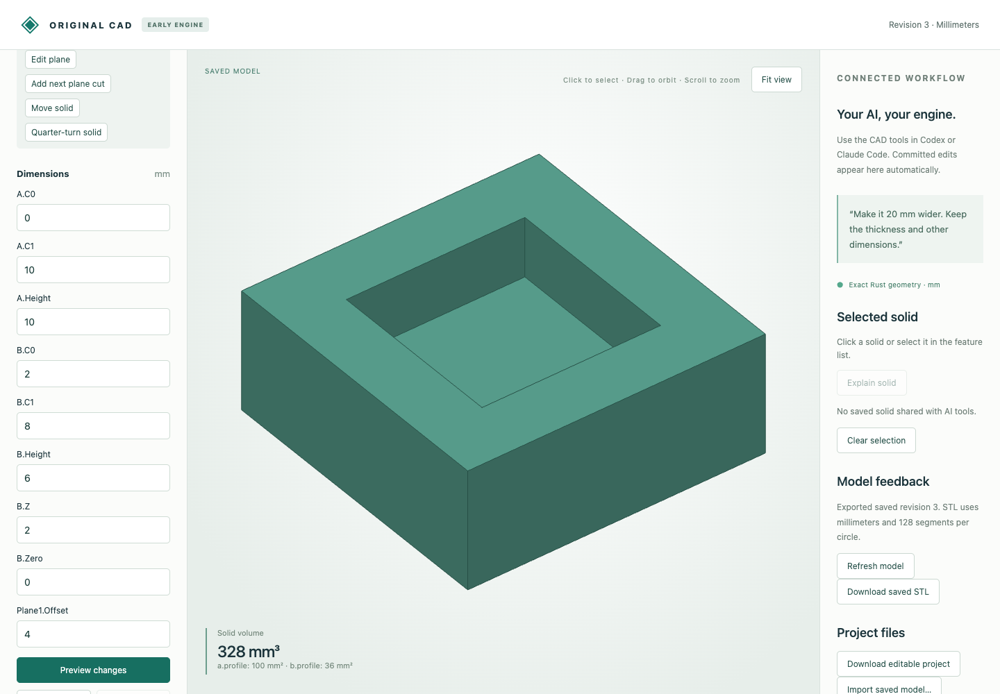

# Plane cuts on nonconvex planar results

The existing exact half-space feature now trims planar Boolean results, including cavities, through-holes and disconnected pieces, and accepts their rigid transforms. Each backing convex cell is clipped; remaining cells regenerate the merged boundary. Empty cells disappear, and the complete result must retain positive volume. Geometry stays in the original Rust engine.

## Actual browser and MCP workflow

[MCP input](mcp-input.cad.json) contains a 10 mm cube minus an internal 6 mm cube at `(2,2,2)`, creating a closed cavity with volume 784 mm³. The browser starts from that synthetic document and clips at z ≤ 5, opening the cavity into a pocket. Editing the offset to 4 makes it shallower. An offset of 0 rejects without saving; undo restores the z ≤ 5 result.

| Native download | Revision | Volume mm³ |
|---|---:|---:|
| [Opened cavity](browser-opened.cad.json) | 2 | 392 |
| [Lowered top](browser-lowered.cad.json) | 3 | 328 |
| [Undo](browser-undo.cad.json) | 4 | 392 |

[Nine actual browser HTTP calls](browser-recording.json) preserve job responses, commits, empty-result rejection and undo. [Downloaded STL](browser-lowered.stl) is a closed oriented pocket mesh with signed volume 328 mm³, interior floor at z=2 and exterior top at z=4. Native files retain editable dimensions, features and history; STL does not.



[Seven actual MCP calls](mcp-recording.json) independently cover creation, preview/save of the cut, offset editing and empty-result rejection. [Input](mcp-input.cad.json), [opened](mcp-opened.cad.json) and [lowered](mcp-lowered.cad.json) native files preserve those stages. These are real typed transport executions without a new inference session.

## Independent STEP comparison

The oracle independently constructs the original solids with OCCT, then intersects them with an independently built half-space. STEP translation sews the supplied Rust boundary; it does not perform modeling cuts.

| Case | Typed source | Finished STEP | Volume mm³ | Material components |
|---|---|---|---:|---:|
| Remove a U-shape's connecting bridge | [model](split_bridge.model.json) | [STEP](split_bridge.step) | 300 | 2 |
| Open internal cavity | [model](open_cavity.model.json) | [STEP](open_cavity.step) | 392 | 1 |
| Oblique cavity cut | [model](oblique_cavity.model.json) | [STEP](oblique_cavity.step) | 392 | 1 |
| Trim through-hole height | [model](trim_hole.model.json) | [STEP](trim_hole.step) | 320 | 1 |
| Open through-hole at side | [model](open_hole.model.json) | [STEP](open_hole.step) | 320 | 1 |
| Remove one separate piece | [model](remove_piece.model.json) | [STEP](remove_piece.step) | 400 | 1 |
| Trim both separate pieces | [model](trim_pieces.model.json) | [STEP](trim_pieces.step) | 400 | 2 |
| Cut moved and quarter-turned hole | [model](placed_hole.model.json) | [STEP](placed_hole.step) | 320 | 1 |

[Measured results](step-comparison.json) check STEP validity, material-component count, volume, surface area and both directed geometric residuals. All units are millimeters. Native results retain exact rationals; STEP uses the documented adapter tolerance and contains no feature history.

## Reproduce

After the [build/setup](../../../tools/ai-cad/README.md), run from the repository root:

```sh
python3 -m unittest discover -s tools/ai-cad -p test_polyhedral_cuts.py -v
node --test tools/ai-cad/test_plane_editor.mjs
python3 tools/ai-cad/verify_polyhedral_cuts.py
mkdir -p work
cp examples/ai-cad/nonconvex-plane-cuts/browser-lowered.cad.json work/pocket.cad.json
python3 tools/ai-cad/viewer.py --store work/pocket.cad.json
```

Run `verify_polyhedral_cut_mcp.py` in an environment with `tools/ai-cad/requirements.lock`; run `verify_polyhedral_cut_export.py` with `tools/ai-cad/step-requirements.txt`. Their optional `--write` regenerates their synthetic MCP/STEP artifact sets. Additional exact tests use seeded oblique planes through a symmetric cavity, unchanged cuts, subsequent transforms/Booleans, zero-normal and empty-result rejection, and native undo/reopen.

Initial concave-profile extrusions, analytic curved stock, curved hole groups and arbitrary imported boundaries remain unsupported. Legacy convex `intersection` is unchanged; use `boolean` for nonconvex intersections. Cell, patch, topology, rational and process limits still apply and may reject a valid complex result. Material components are geometry subsets, not independently editable assembly instances. Face/edge indices are regenerated.

Subsequent support: [simple concave extrusion inputs](../concave-operations/README.md) are now admitted through exact rational decomposition. Earlier initial-stock limitations above describe this checkpoint.
