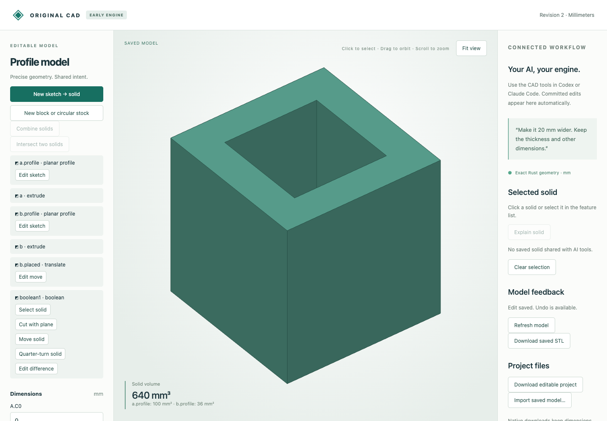

# Original planar solid Booleans

This checkpoint joins/subtracts/intersects planar bodies in the original Rust engine. It supports nonconvex results, face holes, enclosed cavities and separate solid components. These are bounded convex-cell operations, not general curved CAD or an imported-B-rep kernel.

## Recorded editable workflow

The browser starts from a synthetic native fixture containing a 10 mm cube and a 6 × 6 × 12 mm cutter translated to z = -1. The input fixture was prepared through the document host; it was not drawn during this browser recording.

| Native download | Revision | Result |
|---|---:|---|
| [browser-inputs.cad.json](browser-inputs.cad.json) | 1 | Two editable operands |
| [browser-through.cad.json](browser-through.cad.json) | 2 | Difference: square through-hole, 640 mm³ |
| [browser-union.cad.json](browser-union.cad.json) | 3 | Same feature changed to union, 1072 mm³ |
| [browser-common.cad.json](browser-common.cad.json) | 4 | Same feature changed to intersection, 360 mm³ |
| [browser-undo.cad.json](browser-undo.cad.json) | 6 | Two undo actions restore the through-hole, 640 mm³ |

[Actual browser HTTP calls](browser-recording.json) include asynchronous previews, a discarded valid dimension preview, explicit commits, an empty-result rejection and two undo actions. Changing cutter height to 1 while intersecting leaves only face contact and rejects without modifying revision 4. [The downloaded STL](browser-through.stl) has a closed oriented mesh with one through-hole and signed volume 640 mm³. The exact model remains editable in the native downloads.



[Union screenshot](browser-union.png) and [rejected-edit screenshot](browser-rejected.png) preserve the other observed states. A browser automation selector/scroll issue initially failed to open an editor; the operation was subsequently performed and checked against actual saved revisions. The recording contains the successful HTTP activity and does not substitute scripted replies for browser actions.

[Actual MCP calls](mcp-recording.json), [through-hole native file](mcp-through.cad.json), and [intersection native file](mcp-intersection.cad.json) separately verify typed schema discovery, preview/commit, operation replacement, stale rejection and reopen. This is a transport/tool execution test without new model inference.

## Independent geometry/export cases

Each `.model.json` is editable typed model source; each `.step` is its finished translated export. STEP has no parameter or feature history. Millimeters are used throughout.

| Case | Source | STEP | Expected volume mm³ | Material components |
|---|---|---|---:|---:|
| Overlapping union | [model](overlap.model.json) | [STEP](overlap.step) | 1875 | 1 |
| Enclosed cavity | [model](cavity.model.json) | [STEP](cavity.step) | 784 | 1 |
| Through-hole | [model](through.model.json) | [STEP](through.step) | 640 | 1 |
| Split by subtraction | [model](split.model.json) | [STEP](split.step) | 800 | 2 |
| Separate union | [model](separate.model.json) | [STEP](separate.step) | 2000 | 2 |
| Concave L shape | [model](l_shape.model.json) | [STEP](l_shape.step) | 3 | 1 |
| Cavity refilled by union | [model](refilled.model.json) | [STEP](refilled.step) | 1000 | 1 |
| Oblique subtraction | [model](oblique.model.json) | [STEP](oblique.step) | 320 | 1 |
| Intersection of prior holed result | [model](repeated_intersection.model.json) | [STEP](repeated_intersection.step) | 320 | 1 |

[Measured comparison results](step-comparison.json) check STEP validity, material-component count, volume, area and both directed geometric differences against independently constructed OCCT reference operations. OCCT is used for this oracle and for export translation; it never computes the native Boolean result.

## Reproduce

From the repository root, after the [quickstart build](../../../tools/ai-cad/README.md):

```sh
python3 tools/ai-cad/verify_booleans.py
python3 -m unittest discover -s tools/ai-cad -p test_booleans.py -v
cargo +1.85.1 test --manifest-path crates/model-engine/Cargo.toml --locked
node --test tools/ai-cad/test_boolean_editor.mjs
mkdir -p work
cp examples/ai-cad/planar-booleans/browser-through.cad.json work/boolean.cad.json
python3 tools/ai-cad/viewer.py --store work/boolean.cad.json
```

Use a Python environment with `tools/ai-cad/requirements.lock` for `verify_boolean_mcp.py`. Use an environment with `tools/ai-cad/step-requirements.txt` for `verify_boolean_export.py`. `--write` on either verifier deliberately regenerates its corresponding synthetic artifact set.

The contract limits cells, intermediate patches, topology and rational widths. Edge/point-only joins, empty results, initial concave extrusions, and analytic curved/perforated operands reject. Legacy convex intersection still requires convexity. The subsequent [nonconvex plane-cut checkpoint](../nonconvex-plane-cuts/README.md) supports trimming these results. The subsequent [rigid-transform checkpoint](../planar-transforms/README.md) moves and turns complete nonconvex Boolean results. A separate material component within one Boolean feature is not yet an independently addressable assembly component. Face/edge indices are regenerated and must not be treated as persistent names.

Subsequent support: [simple concave extrusion inputs](../concave-operations/README.md) are now admitted through exact rational decomposition. Earlier initial-stock limitations above describe this checkpoint.
