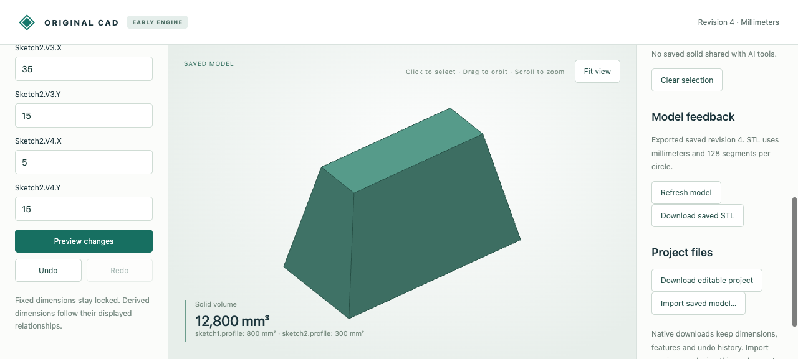

# Exact lofts with planar sides

The original engine joins two convex polygon sections with matching vertex IDs, retaining exact planar faces and rational coordinates. Both profiles live in XY: the bottom is placed atz=0 and the top at a positive section height. This supports tapered and skewed polygonal solids. Nonplanar sides, twisted correspondence and concave sections reject explicitly.

In **New sketch / solid**, choose **Save sketch only** to save each section without creating an extrusion. Then use **Loft profiles**, choose bottom/top sketches and height, preview and save. Edit either source sketch or the section height to rebuild the loft. A single sketch may serve as both sections for a straight prism. Existing solids are retained; profiles can be reused.



## Retained artifacts

- `browser-profiles.cad.json`: both sketches authored in the browser from an empty document.
- `browser-created.cad.json`, `browser-deeper.cad.json`, `browser-undo.cad.json`: native history for a12mm loft, a24mm loft and undo. The taller checkpoint is an actual UI download; the filename follows the common edit-workflow fixture convention.
- `browser-deeper.stl`: actual UI download, independently audited for closure and12800mm³ volume.
- `browser-recording.json`: fifteen actual HTTP calls covering standalone sketches, loft creation, height edit, nonplanar-side rejection and undo. Native replies are retained; display arrays are omitted.
- `mcp-recording.json` and `mcp-*.cad.json`: ten actual typed stdio calls, including measurements/topology, surface selection, guarded height edit, invalid edit and undo. Synthetic transport/schema evidence, without a new model-inference claim.
- Eight `*.model.json`/`*.step` pairs and `independent-comparison.json`: tapered/reversed, triangular, skewed, fractional-height, cut, turned and linked cases. An independent ruled-loft construction is used only as a test oracle. STEP readbacks, shared boundaries, area, bidirectional residual volume, centroid and inertia agree.

The centered rectangular example has cross-section area `(40-10t)*(20-10t)` at`t=z/h`; integration gives volume`1600h/3` and centroid`(20,10,27h/64)`. The12mm model therefore has volume6400mm³ and centroidz=81/16mm. Tests also cover independent profile winding/start indices, identity/adjacency mismatches, exact placement, plane cuts, dependencies and native rollback/reopen/undo.

## Reproduce

Follow the [workflow setup](../../../tools/ai-cad/README.md), then run from the repository root:

```sh
python -m unittest discover -s tools/ai-cad -p test_planar_loft.py -v
python tools/ai-cad/verify_planar_loft.py
# MCP environment:
python tools/ai-cad/verify_planar_loft_mcp.py
# Optional comparison environment:
python tools/ai-cad/verify_planar_loft_export.py
```

The feature is `planar_loft`, with`id,bottom,top,height` references. It requires earlier strictly convex profiles with identical vertex ID sets and matching cyclic edge adjacency. Each side quadrilateral must be exactly planar and the complete result convex. No automatic matching, twisting, triangulation, tolerance-based repair or modeling fallback occurs. Arbitrary planes, curved lofts, multiple intermediate sections, concave sections, apexes and differing vertex counts remain unsupported. The result supports existing planar Boolean/cut/placement/export operations; analytic hole groups still require extrusion/cylinder stock. Evaluated planar surface names remain revision-scoped.
