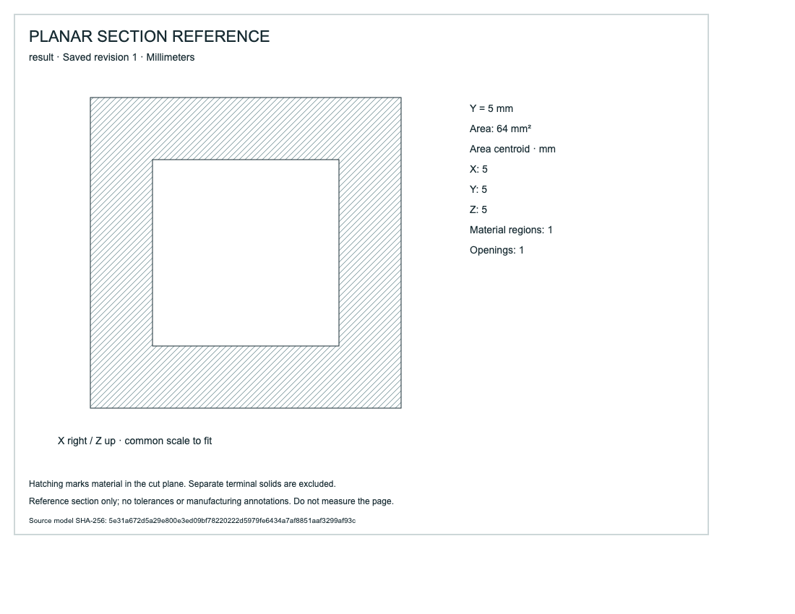

# Exact planar cross-sections

Cut through a closed cavity to inspect material, openings, section area and area centroid. This read-only workflow derives exact contours from original native topology and exports a hatched SVG. It does not cut the saved solid or add a feature.



## Artifacts

- [source.cad.json](source.cad.json), [edited.cad.json](edited.cad.json), [undo.cad.json](undo.cad.json): editable native history at revisions1,2,3.
- [source.svg](source.svg), [edited.svg](edited.svg), [undo.svg](undo.svg): finished section sheets; open in a browser or vector editor. Exact loops, nesting, area, centroid and native hash are embedded as metadata.
- [mcp-recording.json](mcp-recording.json): ten actual typed calls covering source/edit/undo, vertex/empty/curved rejection and stale revision.
- [browser-download.svg](browser-download.svg): actual download, byte-identical to the source MCP output.
- [browser-recording.json](browser-recording.json), [browser-runtime.json](browser-runtime.json): actual failed Y=2 cut followed by a successful Y=5 cut, and unchanged native SHA-256.
- [browser-sheet.png](browser-sheet.png): visually inspected exported SVG with white cavity and hatched material.

The selected part is a10 mm cube minus a6 mm closed cavity. At Y=5 the area is100−36=64 mm² and the centroid is(5,5,5). Reducing cavity height to4 mm gives area100−24=76 mm² and Z centroid(100×5−24×4)/76=101/19 mm. Undo restores the original geometry with a new revision. A separate cylinder tests unsupported curved geometry and does not contribute to the section.

## Reproduce

Build the Rust engine and install `tools/ai-cad/requirements.lock` using the [host setup](../../../tools/ai-cad/README.md), then run from the repository root:

```sh
python tools/ai-cad/verify_sections.py
python tools/ai-cad/verify_sections_mcp.py
python -m unittest discover -s tools/ai-cad -p 'test_sections.py'
python tools/ai-cad/sections.py --store examples/ai-cad/planar-sections/source.cad.json --revision 1 --body result --axis Y --offset 5 --output section.svg
```

Add `--write` to the MCP verifier to regenerate native/SVG/MCP files. Browser evidence is captured separately. In the viewer, select a saved solid, expand **Section through solid**, choose X/Y/Z and enter an integer/fraction world-coordinate offset in millimeters. **Download section (SVG)** reports area and downloads the sheet. AI clients use `cad_section` with the same saved revision, feature ID, axis and offset.

## Geometry and limits

Exact rational edge/plane intersections form face segments. Even-odd pairing along each face supports concavity and holes; closed contour graphs and nesting distinguish outer material, openings and nested islands. Signed polygon integrals produce exact area and centroid. Tests include all three coordinate directions, cavities, through-holes, disconnected parts, concave parts, a nested island,30 independently calculated sloped tetrahedra, small rational distances from vertices, translations and bounded failure paths.

Only planar solids and coordinate-aligned cut planes are supported. A cut through any native vertex rejects explicitly, even if another portion would have a usable section. Select another exact offset; there is no epsilon or silent perturbation. Curves, empty cuts and degenerate/branching contours reject. Only the selected terminal solid participates; native solids/history remain unchanged. Limits:256 edges,128 faces,2048-bit native coordinates,128-bit offset,200000 counted work steps and5 seconds after topology validation. SVG limits:80-character exact labels,4 MiB output, explicit rejection when a segment collapses at display precision. No fixed print scale, persistent drawing association, tolerances or manufacturing annotations.
