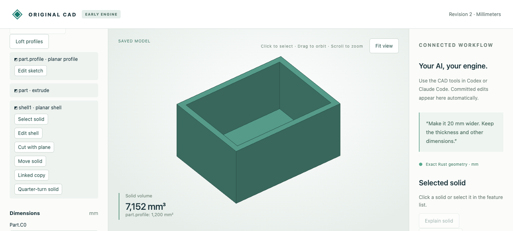

# Exact planar shells

Hollow convex planar stock using a parameter-backed perpendicular wall thickness.
The original Rust engine clips an inset interior and subtracts it from the source;
OCCT is used only by the independent comparisons and STEP adapter.

Open any `*.cad.json` in the viewer with **Import saved model**. The stock is
40 × 30 × 20 mm. **Hollow solid → Preview shell → Save edit** creates a 2 mm
open-top enclosure with exact volume **7152 mm³**. **Edit shell** changes the
thickness or opening. Three-mm walls give **10128 mm³**; closing that cavity gives
**12576 mm³**. An excessive thickness rejects without changing the saved design.



| Artifact | Purpose |
|---|---|
| [Browser stock](browser-stock.cad.json) | Editable starting solid, revision 1 |
| [Open enclosure](browser-created.cad.json) | Saved 2 mm walls, revision 2 |
| [Thicker enclosure](browser-thicker.cad.json) | Actual editable-project download, 3 mm walls |
| [Downloaded STL](browser-thicker.stl) | Closed, oriented triangle boundary of the thicker enclosure |
| [Closed cavity](browser-closed.cad.json) | Actual editable-project download after removing the opening |
| [Undo](browser-undo.cad.json) | Restored opening with native history |
| [Browser recording](browser-recording.json) | Eight editing requests plus four later reads of completed preview records; actual responses retained |
| [MCP recording](mcp-recording.json) | Ten actual typed stdio calls: create, measure, select surface, edit, reject and undo |
| [MCP source](mcp-created.cad.json), [edit](mcp-deeper.cad.json), [undo](mcp-undo.cad.json) | Native checkpoints for the MCP workflow |
| [Comparison report](independent-comparison.json) | Twelve independent explicit-inner-solid references, STEP/shared topology residuals and moments |
| `*.model.json`, matching `*.step` | Editable source models and actual STEP exports for all twelve comparisons |
| [Thicker preview](thicker-shell.png) | Saved 3 mm enclosure after undo |

The twelve comparison names are `closed`, `top`, `bottom`, `left`, `right`, `front`,
`back`, `fractional`, `tapered_closed`, `tapered_open`, `triangle`, and `moved`.
Each STEP file opens as one solid in a STEP-capable CAD application. Source JSON
is the engine model object; native `*.cad.json` files also retain history/receipts.

Run from the repository root after the [quickstart](../../../tools/ai-cad/README.md):

```sh
python3 -m unittest discover -s tools/ai-cad -p test_planar_shell.py -v
node --test tools/ai-cad/test_shell_editor.mjs
python3 tools/ai-cad/verify_planar_shell.py
python3 tools/ai-cad/verify_planar_shell_mcp.py
python3 tools/ai-cad/verify_planar_shell_export.py
```

The MCP verifier needs `tools/ai-cad/requirements.lock`; STEP comparison needs
`tools/ai-cad/step-requirements.txt`. Both `verify_*_mcp.py` and
`verify_*_export.py` support `--write` to refresh their retained artifacts. The
browser recording is an actual manual-automation capture, not regenerated by replay.

Limits: convex planar inputs; one opening selected by outward normal direction,
or no opening for a sealed cavity; positive uniform inward wall thickness. Every
retained face must have a rational normal length so its exact uniform offset is
representable. A 5–12–13 tapered side is supported; an irrational offset rejects.
An unoffset opening face may have irrational normal length. Curved/nonconvex shells,
multiple openings, variable thickness, outward thickening and general fillets remain
unsupported. The existing planar Boolean complexity limits apply. Surface directions
are evaluated references, not persistent face identities after upstream topology changes.
