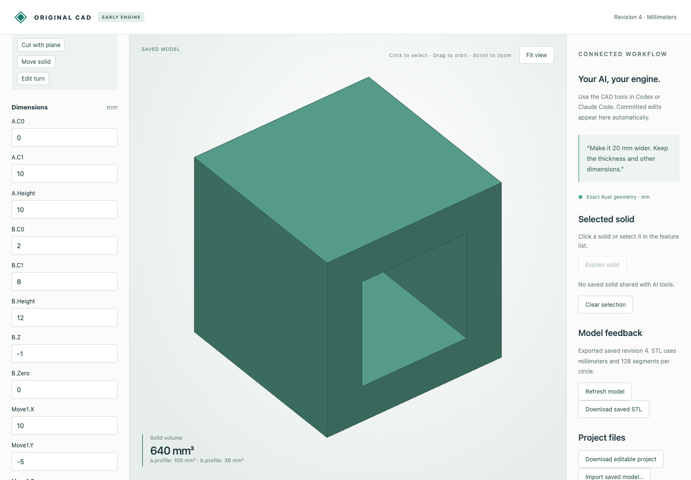

# Move and orient planar Boolean results

Exact translations and quarter turns now accept complete planar Boolean results, including concave faces, through-holes, enclosed cavities and disconnected material pieces. The original Rust engine transforms each backing convex cell and regenerates the merged boundary. Volume and component count stay unchanged, and subsequent Booleans retain the full geometry.

## Actual browser workflow

Start from the [existing synthetic through-hole document](../planar-booleans/browser-through.cad.json), revision 2. The browser moves it by `(10, -5, 3)` mm, rotates 90° about X through `(10, -5, 3)`, then changes the outer profile from 10 × 10 to 12 × 12 mm. Previewing an offset of 1000001 mm rejects atomically. Undo restores the prior dimensions.

| Native download | Revision | Volume mm³ |
|---|---:|---:|
| [Moved](browser-moved.cad.json) | 3 | 640 |
| [Turned](browser-turned.cad.json) | 4 | 640 |
| [Widened upstream](browser-widened.cad.json) | 5 | 1080 |
| [Undo](browser-undo.cad.json) | 6 | 640 |

[The actual twelve HTTP calls](browser-recording.json) retain asynchronous job responses and explicit commits. [Downloaded STL](browser-turned.stl) has a closed oriented through-hole mesh, volume 640 mm³ and world bounds `(10,-15,3)` to `(20,-5,13)` mm. Native files retain parameter/feature history; STL does not.



## Actual typed MCP workflow

[Seven calls](mcp-recording.json) separately create the holed solid, preview/save movement, preview/save the quarter turn, and reject an out-of-range pivot. [Original](mcp-through.cad.json), [moved](mcp-moved.cad.json) and [turned](mcp-turned.cad.json) native files preserve each committed stage. This verifies real tool transport and execution, without a new inference session.

## Independent STEP references

The supplied models move by `(10,-5,3)` and turn 90° about X through that point. Every comparison constructs the source using independent OCCT operations and then independently transforms it; the native model uses only original Rust geometry.

| Geometry | Typed source | Finished STEP | Volume mm³ | Material components |
|---|---|---|---:|---:|
| Through-hole | [model](through.model.json) | [STEP](through.step) | 640 | 1 |
| Cavity | [model](cavity.model.json) | [STEP](cavity.step) | 784 | 1 |
| Split result | [model](split.model.json) | [STEP](split.step) | 800 | 2 |

[Measured results](step-comparison.json) verify validity, component counts, volume, surface area and both directed geometric residuals after STEP round trip. Millimeters are used. STEP translates supplied boundary topology and has no modeling-history data.

## Reproduce

After the [build/setup](../../../tools/ai-cad/README.md), run from the repository root:

```sh
python3 -m unittest discover -s tools/ai-cad -p test_polyhedral_transforms.py -v
node --test tools/ai-cad/test_boolean_editor.mjs
python3 tools/ai-cad/verify_polyhedral_transforms.py
mkdir -p work
cp examples/ai-cad/planar-transforms/browser-turned.cad.json work/turned.cad.json
python3 tools/ai-cad/viewer.py --store work/turned.cad.json
```

Run `verify_polyhedral_transform_mcp.py` in an environment with `tools/ai-cad/requirements.lock`; run `verify_polyhedral_transform_export.py` with `tools/ai-cad/step-requirements.txt`. Their optional `--write` regenerates the synthetic MCP/STEP artifacts, respectively. Tests additionally cover all three axes and all three quarter-turn angles with fractional offsets/pivots, inverse rotation, subsequent nonconvex intersection, upstream edits and atomic failures.

Whole results move together. Individual component instances, assembly joints, arbitrary angles, curved-stock placement and initial concave-extrusion transforms remain unsupported. Existing exact resource/rational limits apply. Plane cuts and legacy convex `intersection` still require convex input; the newer `boolean` feature accepts these nonconvex transformed results. Face/edge indices are regenerated and are not persistent names.
