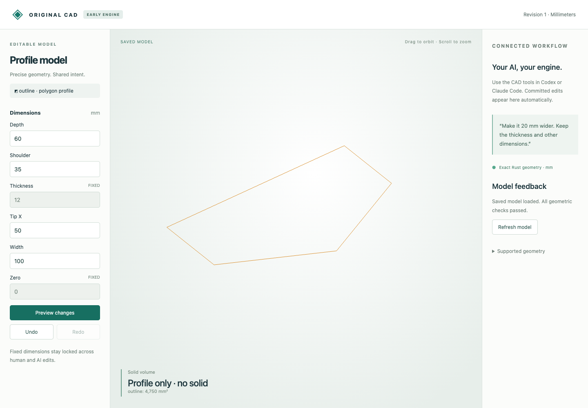
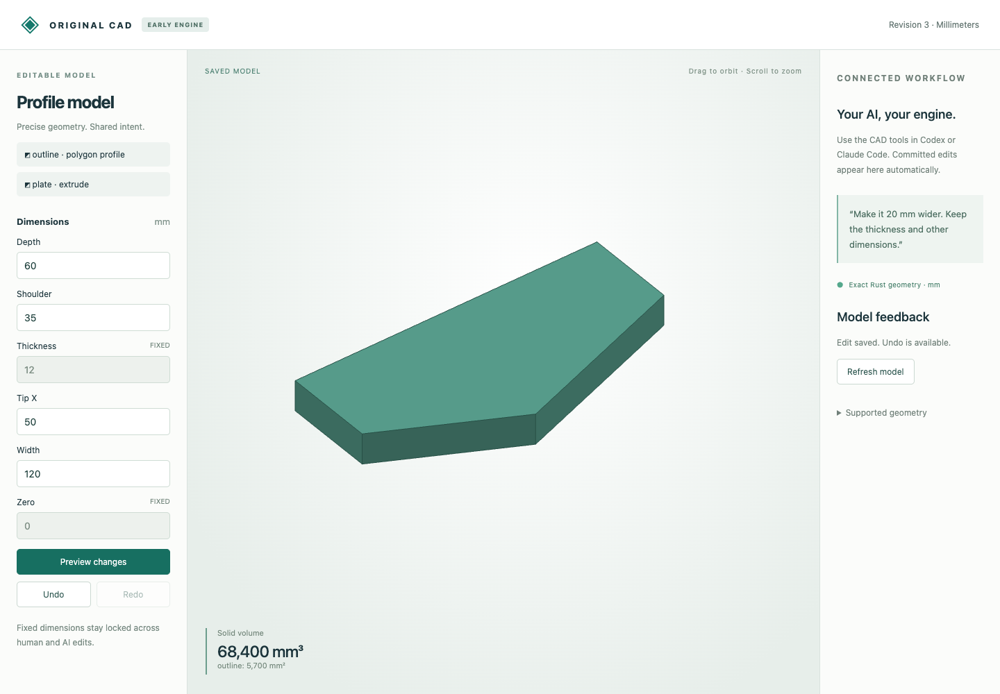

# Editable profile and extrusion

This example uses the original Rust engine to create a five-sided XY profile, extrude it, and widen it by editing one parameter. No OCCT modeling fallback is used.

| Stage | Input | Exact reply | Editable snapshot | Measurement |
|---|---|---|---|---|
| XY outline | [profile.json](profile.json) | [profile.reply.json](profile.reply.json) | [profile.cad.json](profile.cad.json) | 4750 mm², no solid |
| Extrude in +Z | [extrude.json](extrude.json) | [extrude.reply.json](extrude.reply.json) | [extrude.cad.json](extrude.cad.json) | height 12 mm; 57000 mm³ |
| Width 100 → 120 mm | [widen.json](widen.json) | [widen.reply.json](widen.reply.json) | [widen.cad.json](widen.cad.json) | 5700 mm²; 68400 mm³ |

The outline is `(0,0), (width,0), (width,35), (50,60), (0,35)` in mm. Area is `width × (35 + 60) / 2`; width changes leave the tip's x coordinate at 50 mm. This deliberately demonstrates explicit parameter preservation, not an inferred symmetry constraint. Thickness and the shared zero parameter are fixed. Vertex IDs and feature definitions survive the edit.

Build and run from the repository root, using a fresh document path:

```sh
cargo +1.85.1 build --manifest-path crates/model-engine/Cargo.toml --release --locked
mkdir -p work
python3 tools/ai-cad/cad.py --store work/profile.cad.json < examples/ai-cad/profile-extrusion/profile.json
python3 tools/ai-cad/cad.py --store work/profile.cad.json < examples/ai-cad/profile-extrusion/extrude.json
python3 tools/ai-cad/cad.py --store work/profile.cad.json < examples/ai-cad/profile-extrusion/widen.json
python3 tools/ai-cad/viewer.py --store work/profile.cad.json
```

Open http://127.0.0.1:8765. To inspect any saved stage directly, copy its `.cad.json` into `work/` and give that path to the viewer. Keep the published snapshots unchanged. Files are JSON envelopes with checksums and undo history, opened through the document host rather than hand-edited. [Full prerequisites and MCP setup](../../../tools/ai-cad/README.md).




Replay every command and compare the actual results and snapshots:

```sh
python3 tools/ai-cad/verify_profile_example.py
python3 -m unittest discover -s tools/ai-cad -p 'test_profiles.py' -v
```

The example is a deterministic command sequence. MCP transport is tested with the same features; a new natural-language inference run is not claimed. The earlier live conversation recording remains a separate artifact.

Limits: one strictly convex straight-edge loop per profile, 3..32 vertices, positive-Z extrusion, no holes/arcs/fillets or general sketch constraint solver. Stable semantic IDs do not imply stable generated face/edge indices. The viewer is a float display cache; exact geometry and validation run on the CPU. Browser testing does not benchmark physical GPU performance.
