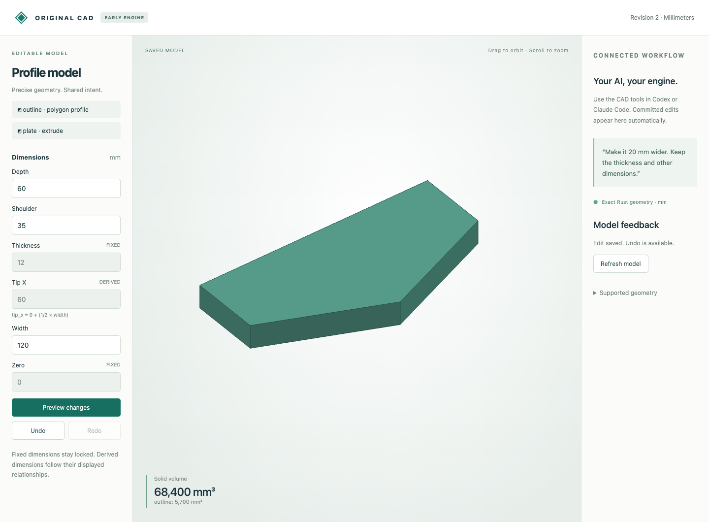

# Symmetric profile with an exact parameter relationship

The five-sided profile's tip remains centered as its width changes. The saved rule is `tip_x = width / 2`; thickness and the shared zero parameter are fixed. The engine owns the dependency calculation, so a human or an AI client only needs to edit width.

| State | Width | Derived tip x | Thickness | Exact volume |
|---|---:|---:|---:|---:|
| Created | 100 mm | 50 mm | 12 mm | 57000 mm³ |
| Widened | 120 mm | 60 mm | 12 mm | 68400 mm³ |

The earlier [profile example](../profile-extrusion/README.md) deliberately preserved a fixed tip x coordinate. This example declares the relationship explicitly. No symmetry is inferred from the shape.

## Artifacts

- [create.json](create.json), [widen.json](widen.json): complete commands.
- [create.reply.json](create.reply.json), [widen.reply.json](widen.reply.json): exact model, rules and geometry results.
- [create.cad.json](create.cad.json), [widen.cad.json](widen.cad.json): editable snapshots with undo/receipts.
- [viewer.png](viewer.png): inspected browser result with derived-field feedback.
- [host-latency.json](host-latency.json): informational operation-latency measurements, source hashes and explicit limits.

## Run and verify

Follow the [prerequisites](../../../tools/ai-cad/README.md), build the Rust engine, and run from the repository root with a fresh working path:

```sh
mkdir -p work
python3 tools/ai-cad/cad.py --store work/related.cad.json < examples/ai-cad/relationships/create.json
python3 tools/ai-cad/cad.py --store work/related.cad.json < examples/ai-cad/relationships/widen.json
python3 tools/ai-cad/viewer.py --store work/related.cad.json
```

Open http://127.0.0.1:8765. The width is editable; the tip x field is derived and displays its relationship. Preview a width change and inspect the new center before saving. Undo restores both values. Copy a published `.cad.json` to `work/` before editing it.

```sh
python3 tools/ai-cad/verify_relationship_example.py
python3 -m unittest discover -s tools/ai-cad -p 'test_relations.py' -v
.venv/bin/python tools/ai-cad/verify_mcp.py
python3 tools/ai-cad/benchmark_workflow.py --samples 10
```

The example replay is deterministic and does not consume inference. A new natural-language conversation is not claimed. Real MCP transport covers adding the relationship, changing its input, rejecting a direct dependent edit and undoing the change.



## Limits

Affine relationships support at most eight nonzero terms each and 64 parameters total, with bounded exact arithmetic. They are directed rules, not a nonlinear or geometric constraint solver. Arbitrary expressions and automatic inference of design intent are unsupported. The profile/solid geometry limits remain unchanged. Older binaries cannot open relationship-bearing documents.

Latency results include process launch, JSON handling and repeated exact CPU validation on one machine. Sequential samples share OS caches. They do not measure GPU performance, isolated kernel execution, memory consumption or large-model throughput. The 64-history workload consists of actual accepted width edits; its results guide future host work and are not CI timing thresholds.
