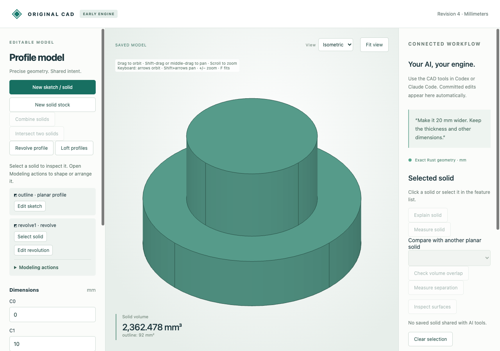

# Editable full profile revolutions

Turn a radius/height polygon through 360° around Z to make stepped shafts, rings,
undercuts and tapered walls. Sketch X is radius; sketch Y becomes axial Z.
The original Rust engine retains exact analytic planes, cylinders and conical
frusta, with rational multiples of pi for volume and exact integral moments.



Import [the source sketch](browser-source.cad.json), choose **Revolve profile**,
and preview/save. The stepped shaft has volume **752π mm³**. Change C1 from 10
to 12 mm and preview/save: volume becomes **972π mm³**. A value of −1 rejects
because the edited polygon is invalid; undo restores the earlier shaft. Source
sketch coordinates and feature identity remain editable. **Edit revolution** can
switch to a different earlier profile; edit the source sketch to change its shape.

| Artifact | Purpose |
|---|---|
| [Source](browser-source.cad.json), [created](browser-created.cad.json) | Native editable sketch and saved revolution |
| [Edited](browser-edited.cad.json), [download](browser-download.cad.json), [STL](browser-edited.stl) | Actual saved/downloaded edit; closed outward mesh at 128 angular segments |
| [Undo](browser-undo.cad.json) | Restored original shape and retained native history |
| [Browser recording](browser-recording.json), [audit](browser-audit.json), [runtime](browser-runtime.json) | Nine actual requests/job replies, invalid draft observation and worker reuse |
| [MCP recording](mcp-recording.json) | Ten actual typed stdio calls: create, measure, inspect/select surface, guarded edit, reject, undo |
| [MCP created](mcp-created.cad.json), [edited](mcp-edited.cad.json), [undo](mcp-undo.cad.json) | Native transport checkpoints |
| [Independent comparisons](independent-comparison.json) | Eleven source-built reference revolutions, two export adapters per shape, moments and directed shape residuals |
| `*.model.json`, `*-stock.step`, `*-shared.step` | Editable reference sources and 22 STEP exports |

Reference names: `stepped`, `solid_cylinder`, `ring`, `tapered_ring`, `undercut`,
`negative_z`, `reversed`, `fractional`, `translated`, `rotated`, `linked`.
Native `*.cad.json` includes history; `*.model.json` is the engine model. STEP
opens in a STEP-capable CAD application and does not preserve native feature history.
The comparison engine builds its reference by revolving the original sketch only
in verification. Export translates the supplied boundary and does not model by sweep.

Run after the [quickstart](../../../tools/ai-cad/README.md):

```sh
python3 -m unittest discover -s tools/ai-cad -p test_revolution.py -v
node --test tools/ai-cad/test_revolve_editor.mjs
python3 tools/ai-cad/verify_revolution.py
python3 tools/ai-cad/verify_revolution_mcp.py
python3 tools/ai-cad/verify_revolution_export.py
```

MCP requires `tools/ai-cad/requirements.lock`; STEP comparison requires
`tools/ai-cad/step-requirements.txt`. The last two scripts accept `--write` to
refresh artifacts. Browser replay checks retained real responses, not a new browser
session. Exact native data compares strictly; disposable mesh floats allow 1e-13
round-trip/libm differences. The STL volume is the sampled polygon approximation
`972 × 128 × sin(2π/128) / 2`, not the exact analytic volume `972π`.

Limits: one simple rational polygon, 3–32 vertices, radii nonnegative. Axis contact
requires exactly one connected axis edge with flat end faces. Isolated apexes,
pinches, multiple axis contacts, partial angles and curved sketch edges reject.
Positive-radius polygons can describe ring sections and undercuts. Translation,
coordinate quarter-turns and linked copies work; general curved Boolean/cut/shell
operations and arbitrary axes are still unsupported. Existing rational coordinate
and geometry budgets apply. STEP's floating adapter additionally requires positive
radii, wall heights and cap gaps above 1e-6 mm, and the existing conical adapter
requires a radius difference above 1e-6 mm. Exact native acceptance is broader.
