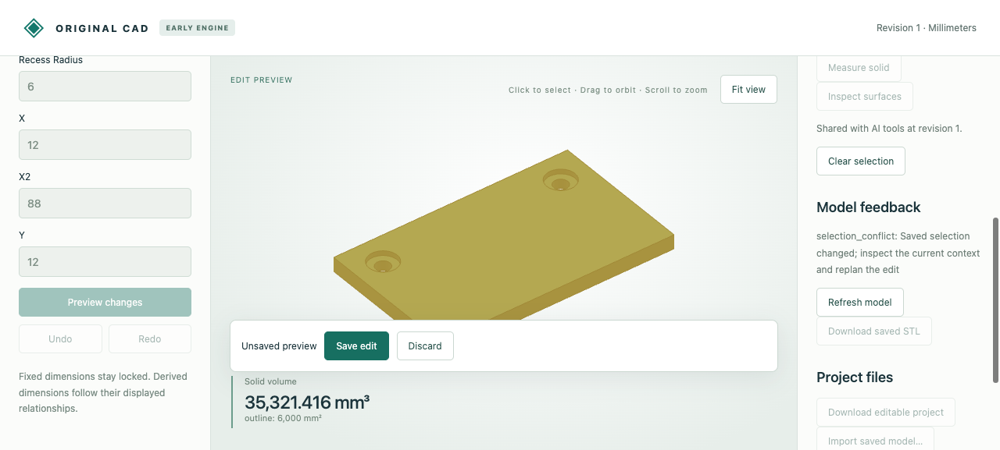

# Guarded surface edits

A valid preview can become inappropriate when someone changes the selected surface without changing the model. Optional selection guards bind the proposal/save to the same current body and surface, in addition to the document revision.



## Retained evidence

- [Initial editable plate](input.cad.json), [saved larger recess](saved.cad.json), and [nine interleaved browser/MCP requests](recording.json).
- The browser selected the left upper recess wall and previewed radius 6. An actual separate MCP process selected the right wall. Browser save returned `selection_conflict`, preserved the preview and left native bytes identical to the input. MCP explicitly reselected the left wall; the same proposed save then succeeded. Display meshes and approximate-volume fields are omitted; exact replies and transport timestamps remain.
- The screenshot shows the real rejection and retained preview. Native files reopen using the viewer's Import saved model command.

## Reproduce

Build/install the [workflow prerequisites](../../../tools/ai-cad/README.md), then:

```sh
python -m unittest discover -s tools/ai-cad -p 'test_selection_guard.py' -v
python tools/ai-cad/verify_selection_guard_recording.py
# With MCP dependencies installed:
python tools/ai-cad/verify_selection_guard_mcp.py
```

The actual MCP verifier performs seven calls: select, guarded preview, select another wall, rejected guarded save, explicit reselection, successful save and identical retry. It verifies native bytes on failure/retry. Unit tests additionally cover body-only/null guards, malformed fields, missing/damaged selection, same-revision content replacement, and selection changes while a real preview subprocess holds an immutable snapshot.

The guard is optional for compatibility. A caller making a selection-dependent edit should retain it through preview/save. It checks current context identity, not permission or proof that operations only affect that surface. Shared feature parameters may affect multiple surfaces/copies. Successful receipt replay returns the committed result before checking now-stale context, so retries cannot duplicate edits. [Full contract](../../../docs/ai-cad-contract.md#selection-bound-edit-preconditions).
