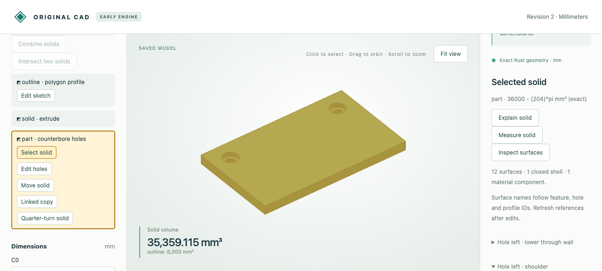

# Shared exact surface inspection

The original Rust engine now constructs explicit line/quarter-circle edges and plane/cylinder faces for all supported analytic stock and hole families, retaining exact world coordinates after placement. Existing planar boundaries use the same inspection response. Exact checks cover supports, orientation, edge ownership, cyclic vertex links, closed shells and component membership.



## Retained artifacts

- [Browser input](browser-input.cad.json), [saved deeper recess](browser-deeper.cad.json), [five actual HTTP calls](browser-recording.json), and the screenshot above. A synthetic counterbored plate was seeded before the browser session. Inspection reported 12 surfaces; preview/save cleared the old information, and reselection exposed the shoulder plane at z=3. Disposable display mesh/approximate-volume fields are omitted from the recording; exact replies are retained.
- [MCP input](input.cad.json), [saved deeper recess](mcp-deeper.cad.json), and [seven actual stdio calls](mcp-recording.json): source/placed inspection, preview/save, refreshed geometry with the same surface names, stale-revision rejection and missing-body rejection. These are actual tool calls, not a new language-model inference demonstration.
- [Independent comparison report](independent-comparison.json): eight shared boundaries translated directly into STEP, read back and checked against independent solid construction/Boolean operations. Checks include validity, cylinder patches, volume, area and both directed residual volumes, all errors below 1e-6 in the reported units.

Each row provides editable source, the complete native boundary and its exported STEP:

| Case | Model | Shared topology | STEP |
|---|---|---|---|
| Counterbores | [JSON](counterbored.model.json) | [JSON](counterbored.topology.json) | [STEP](counterbored.step) |
| Turned counterbores | [JSON](turned_counterbored.model.json) | [JSON](turned_counterbored.topology.json) | [STEP](turned_counterbored.step) |
| Concave plate | [JSON](concave_counterbored.model.json) | [JSON](concave_counterbored.topology.json) | [STEP](concave_counterbored.step) |
| Linked circular stock | [JSON](round_counterbored.model.json) | [JSON](round_counterbored.topology.json) | [STEP](round_counterbored.step) |
| Blind holes | [JSON](blind_plate.model.json) | [JSON](blind_plate.topology.json) | [STEP](blind_plate.step) |
| Cavity | [JSON](cavity.model.json) | [JSON](cavity.topology.json) | [STEP](cavity.step) |
| Separate material | [JSON](separate.model.json) | [JSON](separate.topology.json) | [STEP](separate.step) |
| Planar aperture | [JSON](through.model.json) | [JSON](through.topology.json) | [STEP](through.step) |

Open `.cad.json` files using the viewer's Import saved model command; `.model.json` files are raw engine models (use the `model` field of an engine request). STEP files open in a STEP-capable CAD application. Shared topology JSON is an inspection format, not a supported import format. The verification adapter uses OCCT only to translate/sew the supplied boundary; native modeling does not delegate to it.

## Reproduce

Build the release engine as described in the [workflow guide](../../../tools/ai-cad/README.md), then:

```sh
cargo +1.85.1 test --manifest-path crates/model-engine/Cargo.toml --release
python -m unittest discover -s tools/ai-cad -p 'test_topology.py' -v
python tools/ai-cad/verify_topology_recording.py
# With the MCP dependencies installed:
python tools/ai-cad/verify_topology_mcp.py
# With the optional STEP comparison dependencies installed:
python tools/ai-cad/verify_topology_export.py
```

Native tests cover all retained model fixtures, deliberate boundary damage, certified pi intervals, winding-stable authored names, renamed-hole invalidation, all quarter-turn axes, fractional movement and 1e-21 mm shoulders/depths. Such tiny native dimensions do not imply float STEP/display support.

References are scoped to body and saved revision. Analytic names follow authored roles while those roles exist; planar evaluated indices remain revision-only. This does not add face editing, general curved Booleans, imported-boundary validation, global self-intersection certification or persistent Boolean naming. See the [full contract and budgets](../../../docs/ai-cad-contract.md#shared-surface-topology).
