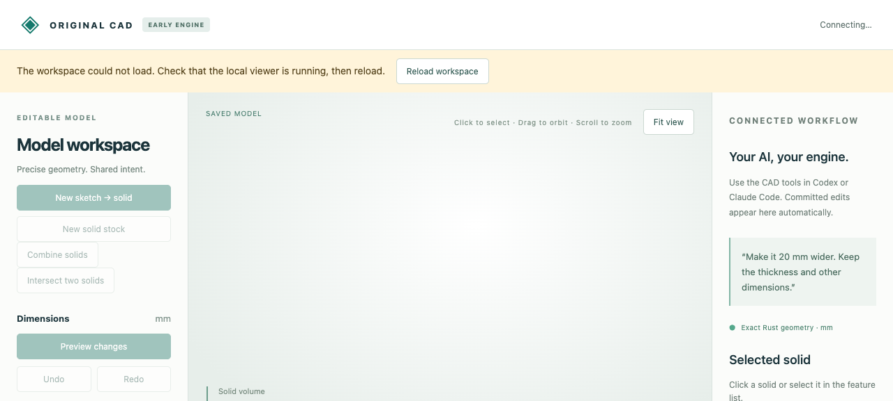
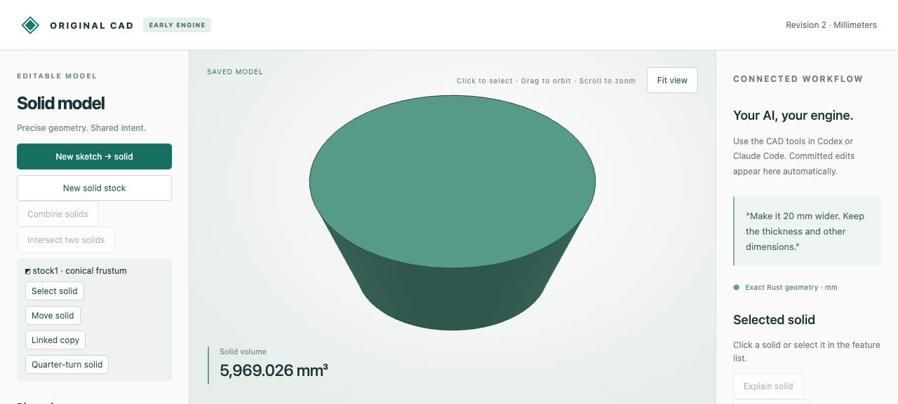

# Recoverable viewer startup

The viewer previously parsed one socket at a time. A browser connection opened without headers could block the next module request indefinitely. The actual socket regression test failed with a one-second request timeout before the fix; with bounded connection parsing, it passes while the idle and partial-header sockets remain open.

`ViewerServer` allows at most16 connection threads and a32-entry listen backlog. Header/body socket I/O times out after5seconds; excess accepted connections receive503 and may retry. Completed HTTP requests still pass through one gate, preserving serialized CAD/cache/export behavior. This improves connection handling, not geometry throughput. Shutdown waits for handlers before closing preview jobs.

If an application module fails to load, the page now shows **Reload workspace** and leaves modeling actions disabled. A ten-second startup delay also exposes recovery; successful initialization hides the notice. Reloading during startup does not change the native document.




`browser-results.json` records an actual browser run with one deliberately injected503 for `stock-model.mjs`, a successful reload, eight subsequent loads and unchanged native bytes. Its input is the retained [tapered stock download](../tapered-stock/browser-wider.cad.json). This fault injection verifies recovery; it is not a claim that every possible original first-load failure had the same cause.

Run from the repository root after the normal [workflow setup](../../../tools/ai-cad/README.md):

```sh
python -m unittest discover -s tools/ai-cad -p 'test_viewer*.py' -v
# Copy the fixture outside the repository before the test-only browser harness:
cp examples/ai-cad/tapered-stock/browser-wider.cad.json /tmp/startup-part.cad.json
python tools/ai-cad/serve_startup_acceptance.py --store /tmp/startup-part.cad.json
```

Open the printed local URL. The first load fails deliberately; **Reload workspace** loads revision2. Stop the harness when finished. The connection tests also cover partial headers, exhausted connection budgets/timeout recovery and concurrent commits retaining revision-conflict semantics. Browser evidence was inspected manually; the synthetic harness does not run in the production viewer.
