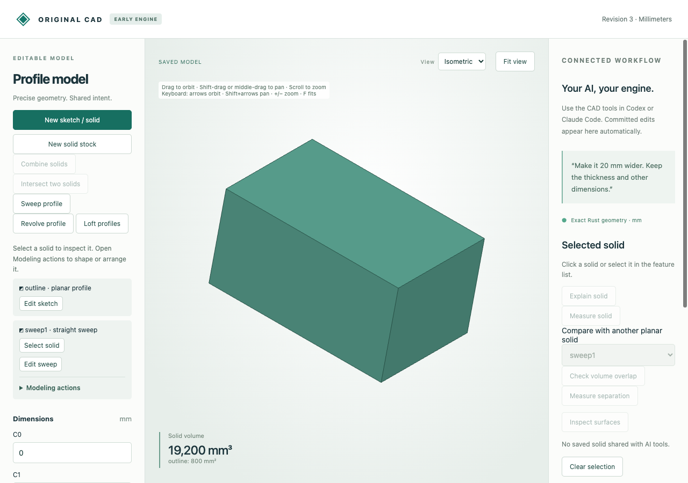

# Exact straight profile sweeps

Sweep a polygon sketch along a straight XYZ displacement to create a slanted solid.
The source cross-section retains its orientation and editable coordinates; the
vector is parameter-backed. Concave sections and either sign of Z are supported.



Import [the sketch](browser-source.cad.json), choose **Sweep profile**, and use
`(7, −3, 12)` mm. Preview/save creates a solid of **9600 mm³**. **Edit sweep** and
change Z to24 mm: volume becomes **19200 mm³**. A zero Z rejects while retaining
the editor draft and saved file; undo restores the earlier solid. **Edit sweep**
can also switch to another earlier sketch.

| Artifact | Purpose |
|---|---|
| [Source](browser-source.cad.json), [created](browser-created.cad.json) | Editable XY sketch and first saved sweep |
| [Edited](browser-edited.cad.json), [download](browser-download.cad.json), [STL](browser-edited.stl) | Actual saved/downloaded edit; closed outward planar mesh |
| [Undo](browser-undo.cad.json) | Restored original sweep with native history |
| [Browser recording](browser-recording.json), [audit](browser-audit.json), [runtime](browser-runtime.json) | Nine actual requests/job replies, rejected draft and worker reuse |
| [MCP recording](mcp-recording.json) | Ten typed stdio create/measure/topology/select/edit/reject/undo calls |
| [MCP created](mcp-created.cad.json), [edited](mcp-edited.cad.json), [undo](mcp-undo.cad.json) | Native checkpoints |
| [Independent comparisons](independent-comparison.json) | Ten reference prisms, STEP readbacks, shared boundaries and moments |
| `*.model.json`, matching `*.step` | Editable comparison sources and usable STEP exports |

Reference names: `slanted`, `reverse`, `negative`, `vertical`, `concave`, `triangle`,
`fractional`, `cut`, `turned`, `linked`. Native files preserve feature history;
STEP exchanges boundary geometry. The reference engine constructs its prisms from
the source sketch only in verification. Native geometry uses original exact rational
planar cells; no sampled display mesh or external modeling fallback defines the solid.

After the [quickstart](../../../tools/ai-cad/README.md), run:

```sh
python3 -m unittest discover -s tools/ai-cad -p test_straight_sweep.py -v
node --test tools/ai-cad/test_sweep_editor.mjs
python3 tools/ai-cad/verify_straight_sweep.py
python3 tools/ai-cad/verify_straight_sweep_mcp.py
python3 tools/ai-cad/verify_straight_sweep_export.py
```

MCP requires `tools/ai-cad/requirements.lock`; comparisons require
`tools/ai-cad/step-requirements.txt`. The last two scripts accept `--write` to
refresh artifacts. Browser replay checks retained actual responses; it does not
launch a fresh browser. Exact native state compares strictly. Display floats allow
1e-13 round-trip differences; closed mesh volume equals the planar solid volume.

Limits: one simple XY polygon, 3–32 vertices; nonzero Z displacement and coordinates
within ±1000000 mm. Existing exact planar-cell/geometry budgets apply. No curved
path, twist or varying section; a vector in the XY plane has no solid volume.
Generated face/edge indices are revision-bound evaluated references. Floating
STEP and display adapters have stricter practical precision than exact geometry.
