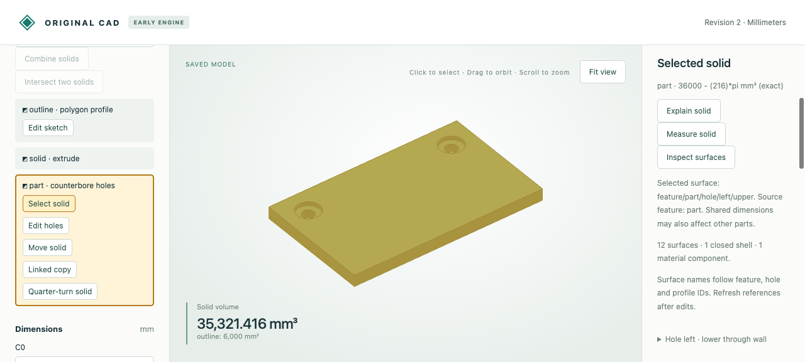

# Human and AI surface context

Select a specific inspected wall, shoulder, cap or plane, then read that same reference through MCP. The context records the chosen saved body, exact surface support and owning feature. Linked copies share authored names and parameters but retain separate body identities and world coordinates.



## Evidence and editable artifacts

- [Browser input](browser-input.cad.json), [saved larger recess](browser-larger.cad.json) and [ten actual HTTP requests](browser-recording.json): select body, inspect, select the left upper wall, preview/save a larger radius, reselect/inspect the new radius, select and clear. Preview/save clears old surface information. Only disposable mesh/approximate-volume fields were removed from recorded replies.
- [Actual MCP read of that browser selection](browser-shared-mcp.json), obtained at revision 1 without changing native bytes. The replay checks the same cross-client context.
- [Initial selection screenshot](browser-selected.png) and [refreshed screenshot](browser-refreshed.png).
- [MCP input with linked copy](input.cad.json), [saved larger radius](mcp-larger.cad.json), [ten actual MCP calls](mcp-recording.json): inspect/select the copy's upper wall, read context, explain its owning feature, preview/commit the larger radius, reject stale selection, reselect, reject an absent name. The explanation reports both source and copy affected by the shared radius.

Open native `.cad.json` files with the viewer's Import saved model command. Selection is disposable workspace context and is intentionally not embedded in native files. These demonstrations use synthetic designs and actual browser/tool transports; they do not constitute a new language-model inference benchmark.

## Reproduce

Follow the [workflow prerequisites/build](../../../tools/ai-cad/README.md), then:

```sh
python -m unittest discover -s tools/ai-cad -p 'test_surface_selection.py' -v
python tools/ai-cad/verify_surface_context_recording.py
# With MCP dependencies installed:
python tools/ai-cad/verify_surface_context_mcp.py
```

Tests verify linked-copy world supports, shared source definitions, atomic rejection, recovery from damaged sidecars, revision/content replacement and undo invalidation, clearing to body-only context, and HTTP/independent-client agreement. Earlier body-only recordings retain their original replies.

Surface selection comes from the inspection list. Viewport highlighting still covers the whole body. References remain body/revision scoped; evaluated planar names are not persistent through changes. Selection is context, not editing authorization. Parameter edits may change multiple surfaces/copies, so explain the owning feature and preview the intended change. [Contract](../../../docs/ai-cad-contract.md#shared-surface-context).
