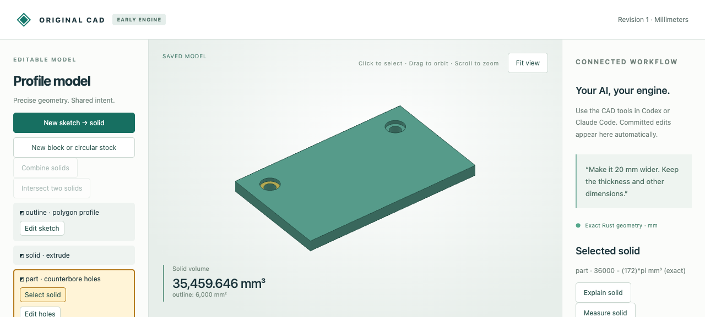

# Pick a native surface in the viewport

The original mesh builder now optionally retains each triangle's generating native surface. Clicking a displayed triangle shares that exact surface reference with AI tools after host validation, and highlights only its triangles.



## Artifacts and evidence

- [Editable input](input.cad.json): a synthetic plate with two stepped holes, unchanged throughout the demonstration. Open it using the viewer's Import saved model command.
- [Complete tagged mesh](tagged-mesh.json): 1044 triangles with 12 native surface references. This is disposable display data; the editable model remains authoritative.
- [Three actual browser selection requests](browser-recording.json): viewport mouse clicks selected the top cap, left upper recess wall and left annular shoulder. Exact supports/owning features returned by the host are retained.
- [Orbit/upload measurements](orbit-metrics.json): zero geometry-buffer uploads across all three picks and a subsequent orbit. The recorded orbit drew 384 vertices (128 triangles) highlighted for the selected shoulder, with the rest unhighlighted. This is a small-model interaction observation, not a large-model throughput benchmark.
- [Screenshot](shoulder.png) showing the isolated shoulder highlight.

## Reproduce

Build the engine using the [workflow guide](../../../tools/ai-cad/README.md), then:

```sh
python -m unittest discover -s tools/ai-cad -p 'test_surface_mesh.py' -v
python tools/ai-cad/verify_surface_picking.py
node --test tools/ai-cad/test_picking.mjs
```

Native-support tests compare tagged and untagged meshes exactly, require all expected surfaces and one reference per triangle, and check every vertex against its tagged plane/cylinder. Cases include counterbores, blind holes, concave stock, linked/turned circular stock, cavities, disconnected solids, planar holes, all quarter-turn axes and fractional placements, plus 256-segment circles. Node tests cover frontmost surface identity, same-name different-body context, missing-provenance fallback, orbit/projection/rebasing, clipping and holes.

Surface tags come from construction, not a nearest-surface heuristic. The host still validates the body/reference at the saved revision before sharing. Picking follows displayed triangles; chord approximation and pixel precision remain relevant. Exact native ray intersections, edge picking and persistent Boolean names are not implemented. The feature-list button retains whole-body selection. [Contract](../../../docs/ai-cad-contract.md#viewport-surface-picking).
