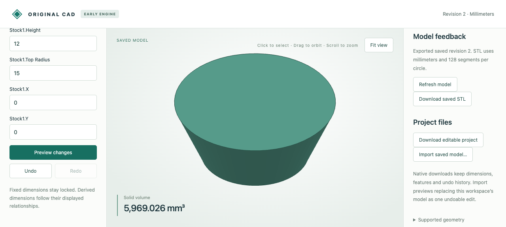

# Tapered round stock

The original Rust engine creates editable conical frusta: two positive, differing radii and a positive height. Native circles/conical supports stay exact. Browser and MCP use the same typed feature and parameters; CPU geometry produces disposable GPU triangles carrying the conical surface reference.

In the viewer, choose **New solid stock → Tapered round stock**, enter bottom radius10, top radius5 and height12, preview and save. Click its conical wall, change the top radius to15, preview and save. Equal radii reject with a cylinder suggestion; undo restores the narrowing part.



## Downloadable evidence

- `browser-created.cad.json`, `browser-wider.cad.json`, `browser-undo.cad.json`: actual browser checkpoints. The wider file was downloaded through the UI and retains native edit/undo history. Import into a separate viewer workspace to inspect.
- `browser-wider.stl`: actual browser download, millimeters,128 segments per circle; triangulated export, not native geometry.
- `browser-recording.json`: twelve actual HTTP requests, including viewport selection of the conical wall, guarded parameter editing, equal-radius rejection and undo. Disposable display arrays are omitted; exact native replies remain.
- `mcp-recording.json`, `mcp-created.cad.json`, `mcp-wider.cad.json`, `mcp-undo.cad.json`: ten actual stdio MCP calls and native checkpoints. These are tool-contract tests with a synthetic document, not a new language-model inference demonstration.
- Seven `*.model.json` sources cover narrowing/widening, fractions, translation, X/Y turns and a linked copy. Fourteen `*-stock.step`/`*-shared.step` files retain analytic conical supports. The stock adapter translates supplied supports; the shared adapter reconstructs supplied face/edge topology. Neither computes native geometry with OCCT.
- `independent-comparison.json`: both STEP readbacks compared with independent OCCT solid constructors, including validity, surface types, area, bidirectional residual volume and exact centroid/inertia. STEP is an optional tolerance-based adapter.

## Reproduce

Build the Rust engine and use the Python environments described in [the workflow](../../../tools/ai-cad/README.md). Run from the repository root:

```sh
python -m unittest discover -s tools/ai-cad -p test_frustum.py -v
python tools/ai-cad/verify_frustum.py
# MCP environment:
python tools/ai-cad/verify_frustum_mcp.py
# Optional STEP comparison environment:
python tools/ai-cad/verify_frustum_export.py
```

Native volume is `pi*h*(r0²+r0*r1+r1²)/3`. Exact polynomial disk integration gives the centroid and centroidal volume inertia; no approximate pi enters native calculations. Tests check closed forms using rational substitutions, all nine quarter turns,256-segment closed meshes, damaged supports and reversible edits.

Both radii must be positive; apex cones and equal-radius cylinders use separate topology. Holes, plane cuts, general curved Booleans and arbitrary rotations on tapered stock are unsupported. STEP requires radii, height and radius difference above1e-6mm; smaller exact native tapers may also exceed display precision and reject tessellation. Native validation remains independent of those export/display limits.
