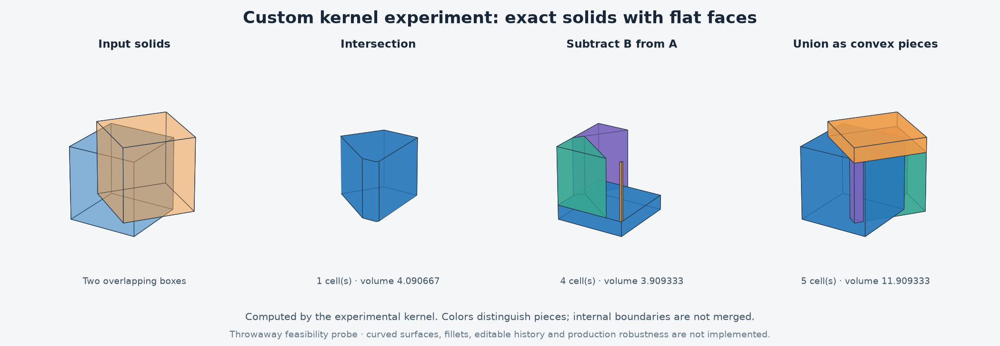

# Custom geometry kernel: first experiment

Date: 2026-10-11
Status: completed feasibility probe; disposable research code, not production implementation.

## Decision and result

Ivan accepted the recommendation to try a bounded custom-kernel experiment before making the entire Fusion recreation depend on it. The approved browser-plus-mini OCCT architecture remains the full-app baseline.

The experiment demonstrates exact operations on convex polyhedra with flat faces. It does not demonstrate an Autodesk ShapeManager replacement. Continue the research with boundary merging and nonconvex planar models before curved surfaces; do not replace OCCT on the strength of these results.

## What actually runs

Original Python code on the Mac mini extrudes strictly convex polygons, applies invertible rational affine transformations, intersects convex solids and computes subtraction/union as collections of convex cells with disjoint interiors. Plane clipping, face construction, topology validation and volume calculation use Python Fraction arithmetic. The experimental operations do not call OCCT.

The code rejects floats, nonfinite values, invalid polygons, nonpositive extrusion heights and singular transforms. Inputs are integers, exact fractions or rational/decimal strings. Contact containing only a face, edge or point is represented as empty volume. Subtraction is a regularized solid operation; constituent cells retain shared boundaries.

Each cell has oriented planar face loops. Validation checks face planarity, convexity, positive volume, opposing edge pairs and the Euler characteristic. This is validation of this restricted representation, not a general CAD validity proof.

## Verification

- 14 automated unittest tests passed using the mini's system Python 3.9; observed runtime 3.023 seconds.
- Corpus includes 120 reproducible rational box pairs and 24 general rationally rotated/transformed cube pairs.
- Checks include analytic volume, operand-order invariance for intersections, volume conservation, nonoverlap of subtraction cells for the box corpus, inverse-transform point membership for rotated cases, and topology.
- Dedicated cases cover face/edge/point contact, disjoint/identical/contained solids, reflections, large coordinate translations, a 1e-30-thick overlap, invalid inputs and intentionally broken boundaries.
- The rotated point checks sample up to 480 points and skip points exactly on original input surfaces, where regularized difference has distinct boundary conventions. A separate test verifies shared internal partition faces are not gaps.

A test initially failed on points lying on internal partition faces. Diagnosis showed the geometry was present, but strict-interior membership excluded those faces. The test now checks closed-cell membership and has an explicit internal-boundary regression. No kernel algorithm was changed for that failure.

## Actual OCCT comparison

Installed a separate SSD-only comparison environment with cadquery-ocp 8.0.1.1.0, exposing OCP version 8.0.1.1. The experiment converts input face loops into OCCT solids, then invokes OCCT's own intersection, cut and fuse operations. No Autodesk runtime is involved.

Eight ordinary cases times three operations produced 24 comparisons. All completed with valid OCCT outputs and valid experimental cells, and all volumes agreed within max(1e-6 cubic units, 1e-8 relative). Maximum absolute volume difference: 2.842170943040401e-14 cubic units.

This establishes measured volume agreement and validity on the corpus. It is not a proof of identical boundaries, feature semantics, or broad kernel compatibility.

Additional tolerance probes:

| Overlap thickness | Exact probe intersection volume | OCCT intersection volume |
|---|---:|---:|
| 1e-3 | 1/1000 | approximately 0.001 |
| 1e-6 | 1/1000000 | approximately 0.000001 |
| 1e-8 | 1/100000000 | 0 |
| 1e-12 | 1/1000000000000 | 0 |
| 1e-30 | 1/10^30 | 0 |

The cross section is one square unit. OCCT ran with default operation/construction tolerances. At 1e-30, conversion to floating point already makes 1-e indistinguishable from 1. Earlier differences reflect the tested tolerance behavior. These deliberately extreme cases are observations, not general superiority claims; changing OCCT tolerances was not evaluated. An absolute volume tolerance alone can label both zero and tiny positive volumes acceptable, so dimensional/contact semantics require separate checks.

Raw timings are retained but not treated as a performance comparison: exact operations return convex cells, while OCCT constructs merged boundaries and supports much broader inputs. Inputs, workload, and output responsibilities are unequal.

## Limits exposed

- Union and subtraction return pieces, with internal faces retained. They do not yet construct one merged manifold boundary with stable face/edge identities.
- Inputs are convex. The output cells can describe a nonconvex result, but there is no general nonconvex input or repeated multi-cell Boolean interface.
- Exact fractions work well for this planar/rational subset. General curved intersections can require irrational or numerically approximated results; this arithmetic choice is not a complete curved-surface strategy.
- No cylinders, NURBS, fillets, shells, geometry repair, durable selection tracking, feature history, persistence, STEP export or interactive application exists in this probe.
- Large-model performance, rational-number growth under long operation sequences, adversarial input limits and production recovery are untested.
- No ASM algorithm was recovered or reproduced, and no Fusion behavior was observed during this experiment.

## Next experiment

Test whether cells can be converted into a single consistent boundary: remove internal faces, split partially overlapping coplanar faces and preserve closed orientation through nonconvex results. Acceptance should include cavities, disconnected components, thin walls and repeated operations. Compare boundary geometry as well as volume. Treat failures and growth in complexity as evidence for retaining OCCT, not a reason to expand the implementation indefinitely.

## Reproduce and locate

Project documentation: /Volumes/SamsungSSD1/code/fusion-recreation, branch main.
Disposable experiment: /Volumes/SamsungSSD1/tools/fusion-recreation/experiments/2026-10-11-rational-kernel.
Isolated comparison environment: /Volumes/SamsungSSD1/tools/fusion-recreation/comparison-env.

From the experiment directory on the mini:

```sh
python3 -m unittest -v
/Volumes/SamsungSSD1/tools/fusion-recreation/comparison-env/bin/python compare_occt.py
```

Files: kernel.py, test_kernel.py, compare_occt.py, comparison.json, comparison-requirements.txt, plot_probe.py, kernel-experiment.png and evidence-manifest.json. Dependency versions are frozen in comparison-requirements.txt. The manifest records source/result hashes. Display rendering converts rational coordinates to floats; the picture is illustrative, while the tests evaluate the exact data.


