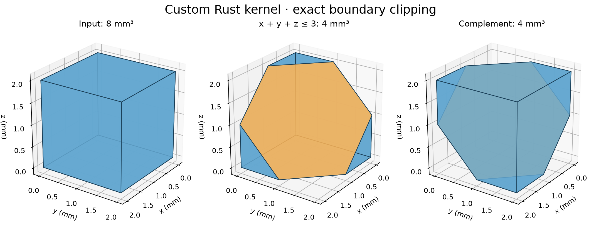

# Exact boundary clipping in Rust

Original custom-kernel research continuing the October 12 shared-topology milestone.
The Rust library clips an **existing convex planar boundary** against an arbitrary
rational plane, retains `normal · point <= offset`, and returns a closed boundary.
It computes intersections, trims face loops and constructs the cap itself. There is
no OCCT, planeGCS, Python geometry backend, FFI, mesh approximation, or vendor code
in the Rust modeling path. The existing C++ application remains a separate track.



The previous Python rational probe already supported convex cell clipping. This
milestone moves the operation onto explicit shared edge/face incidences in Rust;
it does not claim a new general Boolean algorithm or a completed Rust engine.

## Quickstart

Prerequisites: Rust via rustup and Python 3.9+. Run inside this directory of a full
repository checkout; the Python bridge intentionally imports the earlier probes.
`rust-toolchain.toml` pins Rust 1.85.1 and `Cargo.lock` pins dependencies.

```sh
cargo build --release --locked
cargo run --release --locked < fixtures/cube-oblique.request.json
python3 verify.py
```

The supplied fixture cuts a 2 × 2 × 2 mm cube at `x + y + z = 3`. Its exact output
volume is 4 mm³. The saved reply is in `fixtures/cube-oblique.reply.json`.
Output is a versioned JSON boundary containing vertices, shared line edges,
oriented edge uses, planar faces and an exact volume string. It is editable source
geometry, not an STL. No CAD GUI import format is promised by this milestone.

To use an existing shared boundary from Python:

```python
from pathlib import Path
from bridge import clip
# boundary is a topology.Boundary produced by the shared-topology probe.
reply, result = clip(Path("target/release/boundary-clip").resolve(), boundary, (1, 1, 1), 3)
print(reply["volume"], result.summary())
```

## Contract and bounds

- One connected, closed, outward-oriented convex shell with planar convex faces,
  straight edges, and one loop per face. Coplanar face patches and conforming
  collinear edge subdivisions are supported. The all-empty boundary is accepted.
- Scalars are JSON strings containing integers or fractions, such as `"-7/3"`.
  Decimal/exponent strings and JSON floating-point numbers reject explicitly.
  Big integer rational arithmetic is used throughout the Rust geometry path.
- Schema 1 is the exact planar subset of shared topology. The bridge checks
  zero tolerance and exact scalar types; it never converts approximate curves to
  planar input. It reconstructs returned incidences directly for validation.
- Face/edge/point-only contact returns the empty solid (regularized semantics).
  Existing supporting planes return unchanged geometry. Complementary half-spaces
  partition volume exactly. Results can be clipped repeatedly.
- Limits: 1 MiB CLI request, 128 vertices, 384 edges, 128 faces, 768 edge uses,
  and 1,024 bits each for rational numerators and denominators. The result must
  also satisfy these limits; excessive arithmetic growth rejects the operation.
  Bounds reduce resource exposure but do not establish a network-service SLA.
- Invalid incidence, duplicate coordinates/edges, open loops, nonmanifold edges
  or vertex links, reversed faces, off-plane vertices, nonconvexity, unsupported
  surfaces, face holes, invalid numbers and unsupported schemas return an error.
  The CLI writes an error JSON to stderr, exits 2, and writes no success output.
- Vertex/edge indices describe this result only. Persistent selection naming,
  general shell repair, nonconvex Boolean operations, cavities, curved clipping,
  fillets and a full application are outside this milestone.

## Validation

```sh
cargo fmt --check
cargo clippy --locked --all-targets -- -D warnings
cargo test --locked
cargo build --release --locked
python3 verify.py
```

The 14 end-to-end tests cover analytic boxes/tetrahedra, contact, cuts through
existing edges/vertices, 40 seeded rationally transformed solids, complementary
volume conservation, repeated/order-independent cuts, plane rescaling, subdivision,
round trips, 1e-30 thickness, 1e30 translation and malformed inputs. The earlier
Python cell clipper is an additional reference only. Shared topology validates
the returned Rust incidences without repairing them. Two Rust unit tests cover
the rational parser and empty input/invalid planes.

Optional independent reference checks require `cadquery-ocp==8.0.1.1.0` in an
isolated environment. Rendering additionally requires Matplotlib. These packages
are used by comparison/illustration tools, not the Rust engine.

```sh
python compare_occt.py
python render.py
```

The saved report records 48 OCCT comparisons across complementary and repeated
cuts, checking validity, connected shells, volume, area and 5,698 bidirectional
surface samples. Extreme exact-coordinate fixtures are not compared with OCCT.
Finite samples do not establish general geometric equivalence. CI runs the Rust
checks, bridge checks and OCCT comparison on Linux; the existing dependency-free
Python regression suite remains separate.

## Artifacts and layout

| Path | Purpose |
|---|---|
| `src/lib.rs`, `src/main.rs` | Original Rust geometry code and one-request CLI |
| `bridge.py` | Lossless exact-planar shared-topology interchange |
| `fixtures/*.json` | Reusable input and actual computed output |
| `verify.py` | End-to-end exact and rejection checks |
| `compare_occt.py`, `occt-comparison.json` | Reproducible reference comparisons and measured evidence |
| `render.py`, `boundary-clipping.png`, `boundary-clipping.svg` | Reproducible illustration plus raster/vector exports |
| `Cargo.lock`, `rust-toolchain.toml` | Reproducible Rust dependencies/toolchain |

Build outputs are excluded; the source, fixtures, results and illustrations are
retained in Git. For issues, provide the JSON request, toolchain, error and expected
geometry. Changes use focused branches, the checks above, and reviewed PRs.

This private research does not assign a new public license to project code or
artifacts. Dependency licensing is listed in [THIRD_PARTY.md](THIRD_PARTY.md);
licensing must be resolved before a public release.

## Next milestone

Compose these half-space operations into a bounded **convex solid–solid
intersection** directly from shared boundaries, retaining exact predicates and
independent comparisons. General nonconvex unions/differences and curved-surface
intersections still need explicit design and additional validation.
